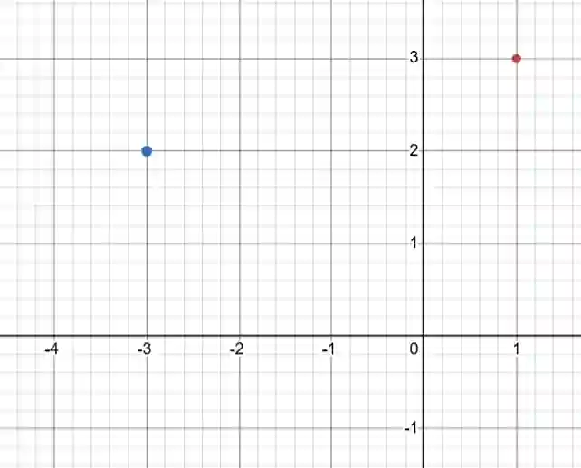

# Coordinate Geometry

## Cartesian Plane

* A graph consists of two axes: a $y$-axis and an $x$-axis

  * x-axis is horizontal

  * y-axis is vertical

* Coordinates are written in the form $(x, y)$

* Origin is $(0, 0)$

* Example: Plot $(1, 3)$ AND $(-3, 5)$

  * Red: $(1, 3)$

  * Blue: $(-3, 2)$

  