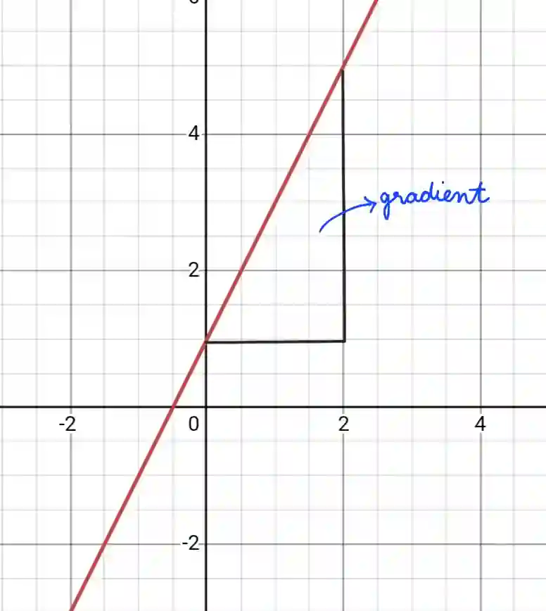

## Gradient

* Gradient of line measures the steepness, also known as the slope of the graph  ($m$)

* Formula :

$$

\boxed {m = \frac{y_2 - y_1}{x_2 - x_1}}

$$

* If $m$ = 0 then it’s a horizontal line

* If $m$ = undefined then its a vertical line

* If $m$ = negative value then the line goes down from left to right

  

* Example: Find gradient of line AB, where A is (-2, 5) and B is (1, -7)

  $= \dfrac{-7-5}{1-(-2)}$

  $=\dfrac{-12}{3}$

  $= -4$

  $\therefore$ $m=-4$