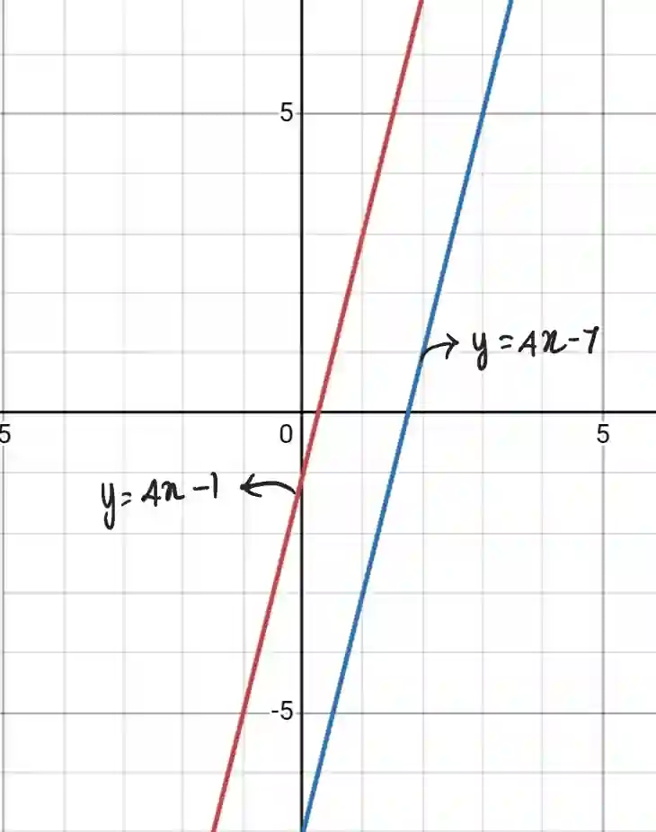
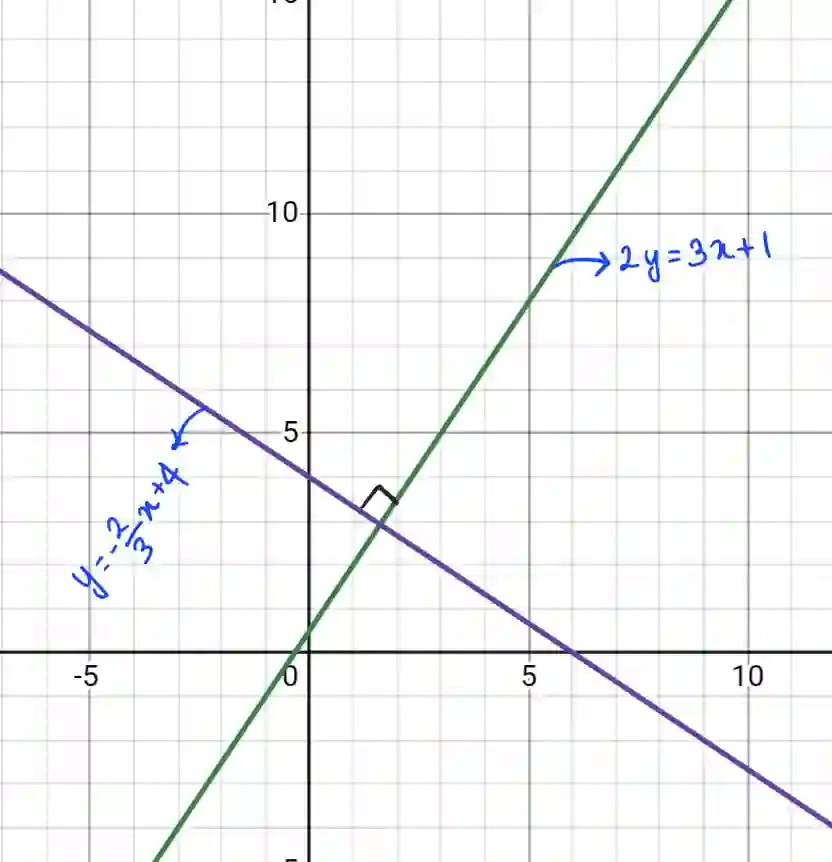

## Parallel and Perpendicular lines

**Parallel Lines**

* Two or more lines in the same plane that are always the same distance apart and never intersect

* Have **same gradient**

$$

\boxed {(m_{1}=m_{2})}

$$

* Example : Find equation of line parallel to $y=4x-1$ which passes through (1, -3)

  As the lines are parallel the gradients are same so, $m=4$

  $y-y_1 = m(x - x_1)$

  $y - (- 3) = 4(x - 1)$

  $y + 3 = 4x - 4$

  $y=4x - 4 -3$

  $\therefore$ $y=4x - 7$ , Where gradient$(m)=4$ and y-intercept$(c)=-7$ and says $y=4x-1$ and $y=4x - 7$ are parallel

  

**Perpendicular Lines**

* Two lines that intersect or cross at a perfect right angle ( $90 \degree$)

* Gradient of a line perpendicular to another line is the negative reciprocal of its gradient

  $$

  \boxed {m_1 \times m_2 = -1}

  $$

* Example: if $m_1 =2 $ then $m_2 = \dfrac{-1}{2}$

* Example: Find the gradient of the line perpendicular to $2y = 3x+1$ and equation of the bisector passing (9, -2)

  * Convert to $y=mx+c$

    * $y=\dfrac{3x +1}{2}$

  * Change gradient to negative reciprocal and solve to find equation

    $m_1 = \dfrac{3}{2}$, $m_2 = \dfrac{-2}{3}$

    $y-y_1 = m(x - x_1)$

    $y-(-2) = \dfrac{-2}{3}(x - 9$)

    $y+2 = \dfrac{-2x}{3} + \dfrac{18}{3}$

    $y= \dfrac{-2x}{3} + 6 - 2$

    $\therefore$  $y = \dfrac {-2x}{3} + 4$, Where gradient$(m)=\dfrac{-2}{3}$ and y-intercept$(c)=4$ and says

    $2y =3x+1$ and $y= \dfrac{-2x}{3} + 4$ are perpendicular to each other

    