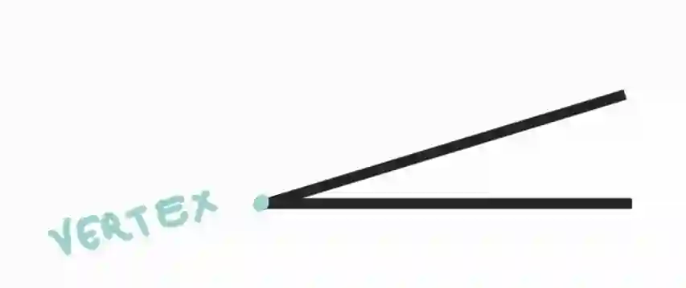
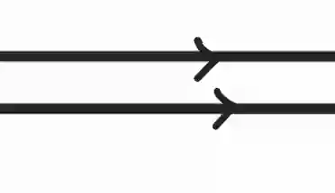
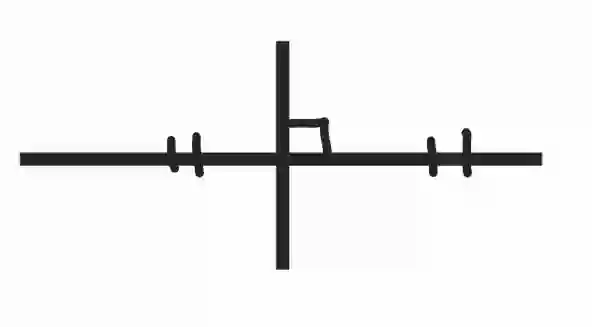
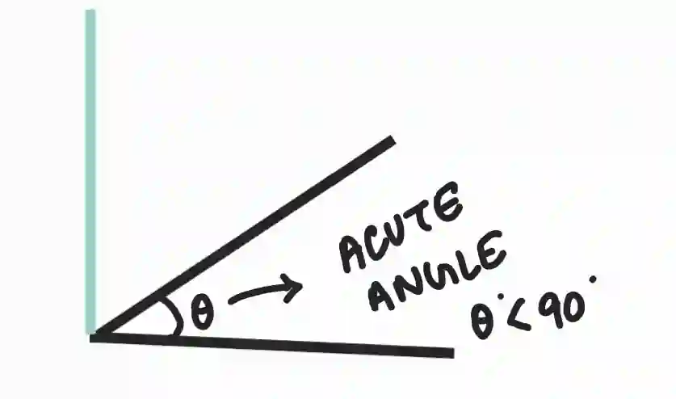
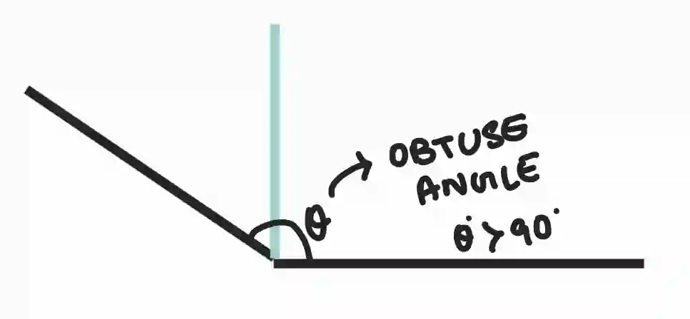
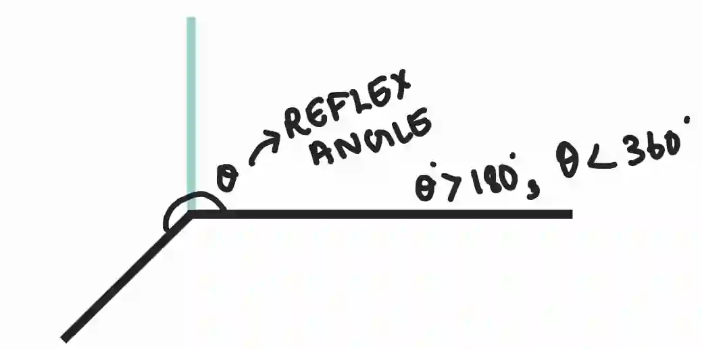

# Geometry

## Geometrical terms

#|
||

**Term**

|

**Definition**

||
||

Point

|

Exact position in space It has **no size** (no length, width, or thickness)

||
||

Vertex

|

The point where **two or more lines or edges meet**, forming an angle

||
||

Line

|

Straight path that extends **infinitely in both directions**

||
||

Plane

|

A **flat, 2D surface** that extends infinitely in all directions.

||
||

Parallel

|

Lines with the same gradient, and they do not intersect at any point

||
||

Perpendicular

|

If they intersect at a **right angle (90°)**

||
||

Perpendicular bisector

|

A line that cuts another line **exactly in half** at **90°**

||
||

Bearing

|

The direction of one point from another, measured **clockwise from North**, and written as a **three-digit angle**

||
||

Right angle

|

Angle exactly **90°**

||
||

Acute angle

|

An angle less than 90°

||
||

Obtuse angle

|

An angle greater than 90° but less than 180°

||
||

Reflex angle

|

Angle **greater than 180° and less than 360°**

||
||

Interior angle

|

An angle **inside a shape**, especially inside a polygon.

||
||

Exterior angle

|

Angle formed **outside a shape** when one side of the shape is extended.

||
||

Similar

|

Shapes are **similar** if Corresponding **angles are equal**, and Corresponding **side lengths are in the same ratio**

||
||

Congruent

|

Shapes are **congruent** if ,They are the **same shape and the same size ,**All corresponding sides and angles are equal

||
||

Scale Factor

|

Number of times a shape is enlarged or reduced

||
|#

