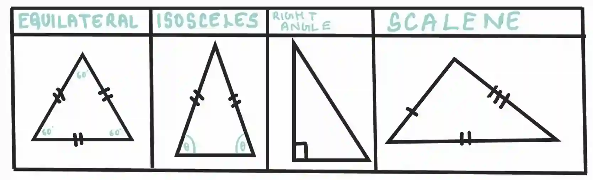

## Triangles

#|
||

Equilateral

|

Isosceles

|

Right-angled

|

Scalene

||
||

* All three sides are equal in length

* All three angles are equal, each measuring 60**°**

|

* Two sides are equal in length

* The angles opposite the equal sides are equal

|

* One angle is exactly 90**°**

|

* All three sides are different lengths

* All three angles are different

||
|#

