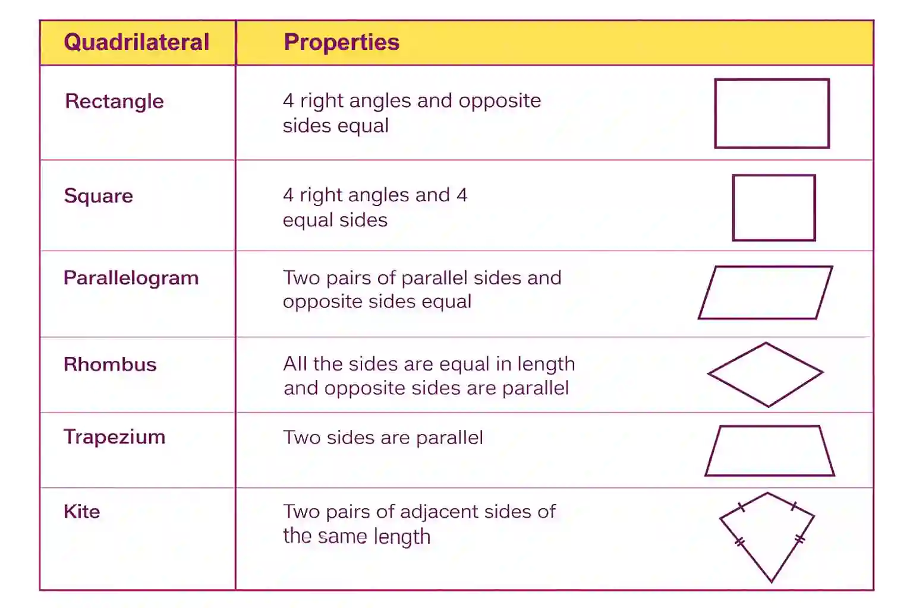

## Quadrilaterals

* A polygon with **4 sides**, **4 vertices**, and **4 angles**

  * Sum of interior angles = 360°

  * Can have equal or unequal sides and angles

  * Can have parallel sides

### **Special Quadrilaterals**

* Trapeziums (trapezoid), parallelograms, kites, rectangles, rhombuses, and squares are special quadrilaterals
* That have equal and parallel sides

