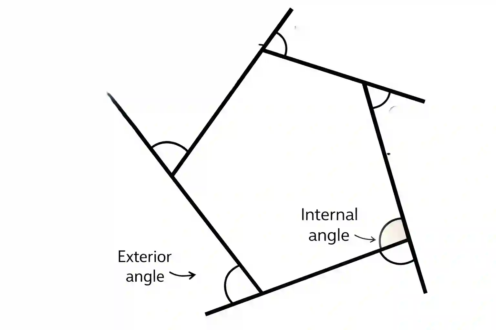

## Polygons

* A 2D closed shape made only of straight line segments

### **Types** of polygon

* Regular :

  * All sides equal

  * All interior angles equal

  * Examples: Pentagon, Hexagon, Octagon, Decagon

* Irregular

  * Sides and angles are not all equal

### **Interior and Exterior angle of polygon**

* Interior Angle

  $$
  \boxed{\text{Sum of Interior Angle}=(n - 2) \times 180}
  $$

  * Where $n$ is number of sides

  * Example: Pentagon

    $(5-2)\times 180 = 540\degree$

* Exterior angle

  * Sum of exterior angles is always $360\degree$

    $$
    \boxed{\text{Each Exterior Angle}\frac{360}{n}}
    $$

  * Where $n$ is number of sides

  * Example: Pentagon

    $\frac{360}{5} = 72\degree$

