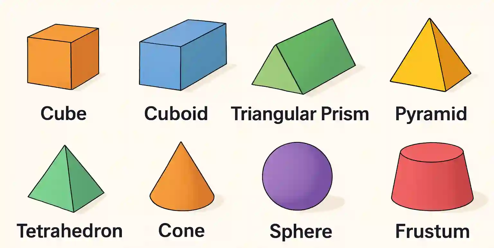

## Solids

* A solid is a three-dimensional shape that has:

  * Length

  * Breadth (width)

  * Height

* Solids occupy space and have volume

### **Terms**

* **Face:** A flat or curved surface of a solid

* **Edge:** The line where two faces meet

* **Vertex:** The point where edges meet

* **Curved surface:** A rounded surface (no edges)

**Examples** :

### Properties of Solids (3D-shapes)

#|
||

Name of Shape

|

Face

|

Edge

|

Vertex

|

Plane of symmetry

|

Rotational symmetry

||
||

Cube

|

6

|

12

|

8

|

9

|

Order 4

||
||

Cuboid

|

6

|

12

|

8

|

3

|

Order 2

||
||

Triangular Prism

|

5

|

9

|

6

|

1 (if symmetric triangle)

|

Order 2

||
||

Square Pyramid

|

5

|

8

|

5

|

4

|

Order 4

||
||

Tetrahedron (Regular)

|

4

|

6

|

4

|

6

|

Order 3

||
||

Cone

|

2 (1 curved + 1 circular base)

|

1

|

1

|

infinite

|

infinite

||
||

Sphere

|

1 (curved surface)

|

0

|

0

|

infinite

|

infinite

||
||

Frustum

|

3 (2 circular + 1 curved)

|

2 (circular edges)

|

0

|

infinite

|

infinite

||
|#

***Frustrum:** A frustum is the portion of a solid (usually a cone or a pyramid) that remains after the top is cut off by a plane parallel to the base.

*In simple terms:*

*If you slice the top off a cone or pyramid straight across, the bottom part that remains is called a frustum*