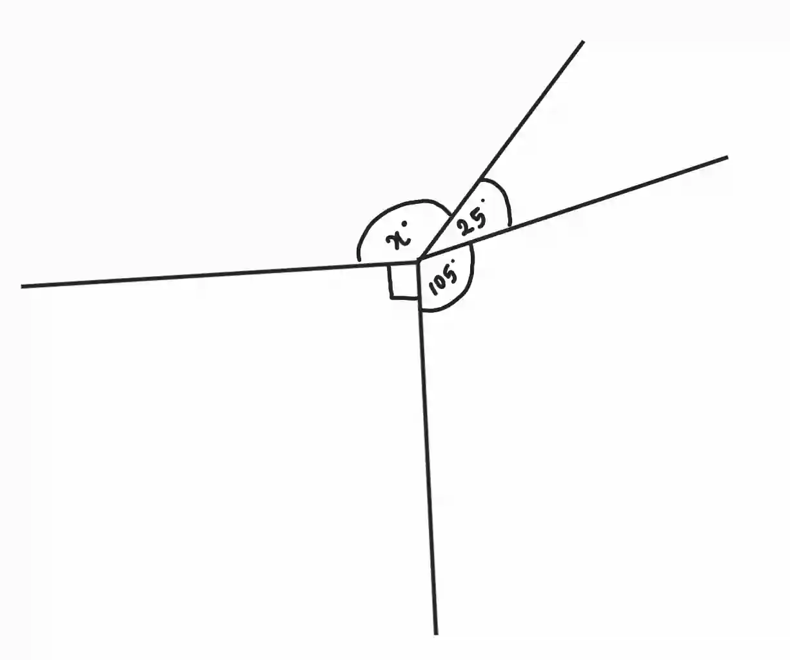
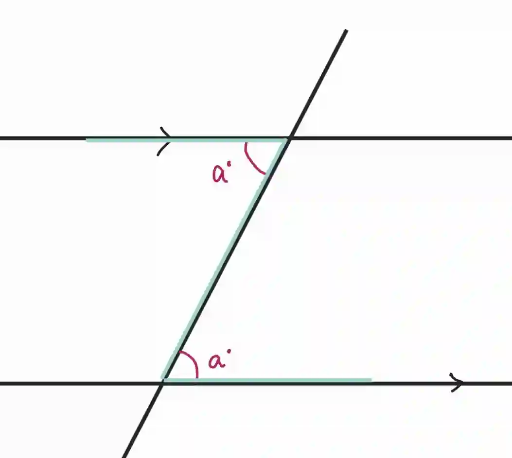
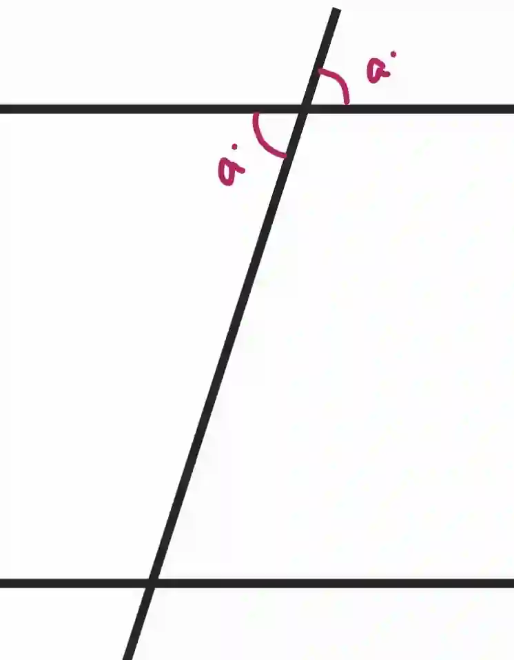
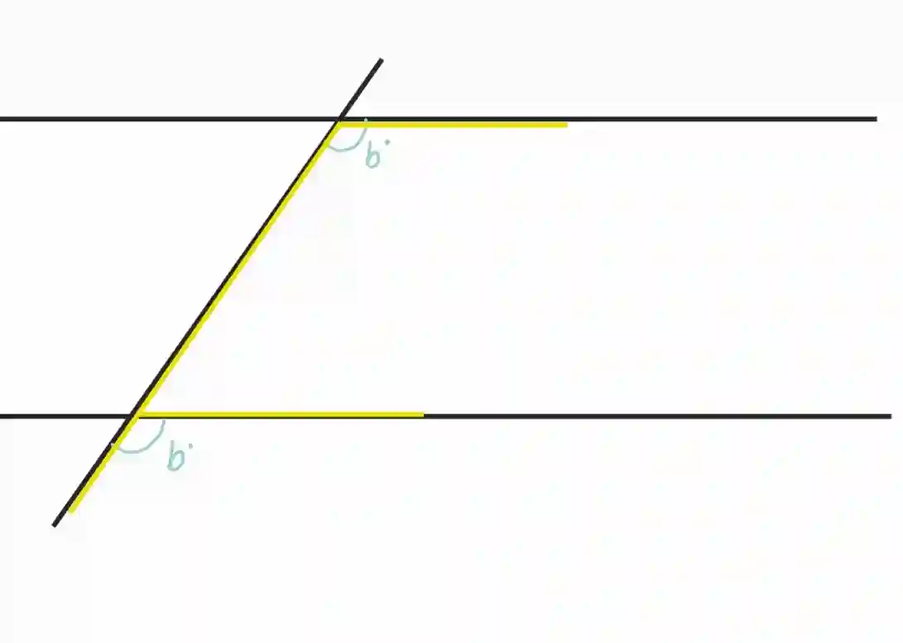
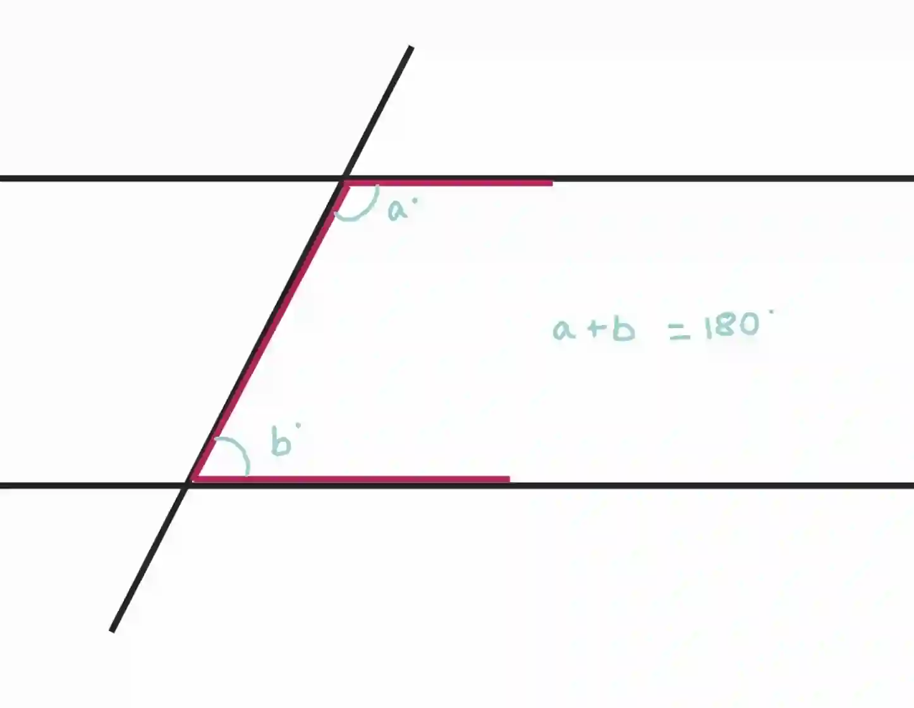
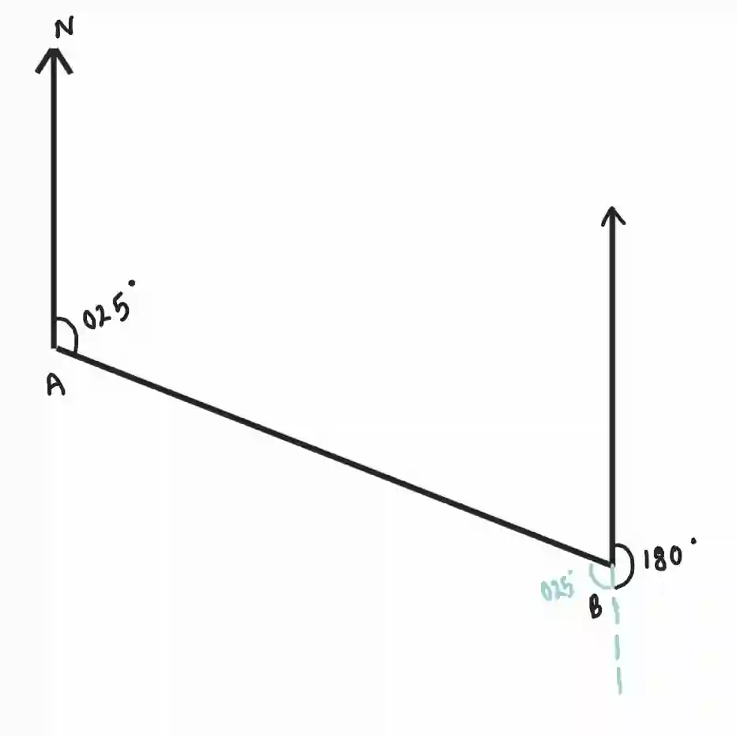

## Angles

### **Angles around a point**

* Sum of angles around a point is 360°

* A full rotation around a point brings you back to the starting position, completing a circle which measures 360°

* Example: Find $x$

  

$x= 360-90-105-25=140°$

### **Angles in a straight line**

* Angles on a straight line add up to 180°

* If a line intersecting another line is perpendicular they form 90° at each intersection

### **Alternate and corresponding angles**

* Alternate interior angles are equal, they form a Z shape

  

* Alternate exterior angles are equal

* Vertically opposite angles are equal, they form an X shape

  

* Corresponding angles are equal, they form an F shape

  

* Supplementary angles (Same side interior angle) add up to 180°

  

**Bearings**

* Measured clockwise from north (000°- 360°)

* Written in 3 figures like 360°, 270°, 047°

* Example: Find the bearing of $A$ from $B$ if bearing of $B$ from $A$ is 020°

  

* Bearing of $A$ from $B$ is $180° + 025° = 205°$

Remember, you should be able measure and draw angles using protractor and ruler

* Make sure you understand that angle $ABC$ means angle $B$