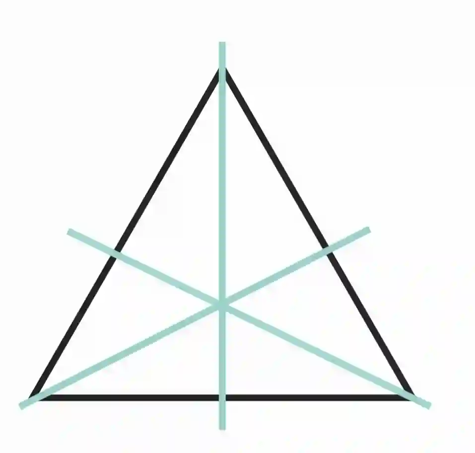
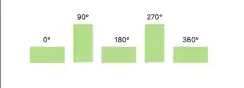

## Symmetry

### **Line of symmetry**

* A figure has line symmetry if one half is a mirror image of the other half

* The line that divides the figure into two identical halves is called the line of symmetry

* For example, an equilateral triangle has 3 lines of symmetry

  

### **Rotational symmetry**

* ### The order of rotational symmetry is the number of times the figure matches itself during a full 360° rotation

* All shapes have an order of rotational symmetry of 1 or more

* For example, a rectangle with an order of rotational symmetry of **2**

* The figure matches itself at 180° and 360°

