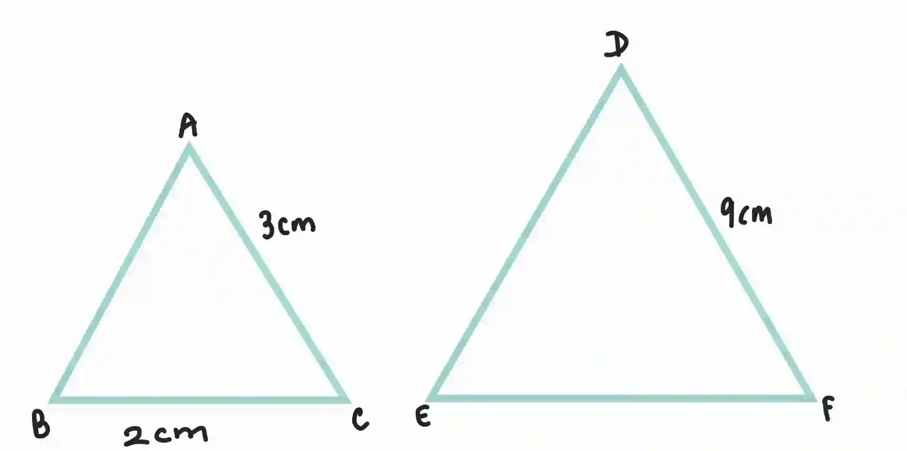

## Similarity

* Similar shapes have equal corresponding angles

* The corresponding sides of a similar shapes are proportional

* The **ratio of corresponding sides** of similar shapes is known as **scale factor**

  $$
  \boxed {\text{Scale Factor (SF)} =\frac{\text{Length in new shape}}{\text{Length in original shape}}}
  $$

  * $SF > 1$ → **enlargement**

  * $SF < 1$ → **reduction**

  * $SF = 1$ → **congruent shapes**

### **Calculating length of similar figures**

* Calculate scale factor using the above formula

* Use formula and substitute the values

  $\text{New Length} = SF \times \text{Original length}$

* Tip: always divide new value by original value, even if the new shape is smaller

* Example: △ABC and △DEF are similar. find the length of EF when BC is 2

  

  * SF=$\frac{9}{3} = 3$

  * EF = $ 3 \times 2 = 6$

### **Calculating Surface area and Volume of similar figures**

* Square of scale factor is surface area scale factor. Multiply the area factor with the smaller similar figures area to find the area of the larger figure

  $\text{New area} = (SF)^2 \times \text{New area}$

* Cube of scale factor is volume scale factor. Multiply the volume factor with the smaller similar figures volume to find the volume of the larger figure

  $\text{New Volume} = (SF)^3 \times \text{New Volume}$

* Example: Two similar prisms have a scale factor of $\frac{4}{3}$​ If the surface area of the larger prism(A) is $320 cm^2$. Volume of the smaller prism is 216 $cm^3$

  What is the surface area of the smaller prism(B) and what is the volume of the larger prism?

  1. Surface Area of prism B

     * Surface area varies as the square of the scale factor:
       $(SA)^2 = \left(\frac{4}{3}\right)^2 = \frac{16}{9}$

     * Given surface area of the larger prism,
       $\text{SA}_A = 320\text{cm}^2$

       $\text{SA}_A = \frac{16}{9}\times \text{SA}_B$

       $\text{SA}_B = 320 \times \frac{9}{16}$

       $\text{SA}_B = 180\text{cm}^2$

  2. Volume of larger prism

     * Volume varies as the cube of the scale factor:
       $k^3 = \left(\frac{4}{3}\right)^3 = \frac{64}{27}$

     * Given volume of the smaller prism,
       $\text{V}_B = 216\text{cm}^3$

       $\text{V}_A = \frac{64}{27}\times 216$

       $\text{V}_A = 512\text{cm}^3$