## Circle Theorems

1. Angle in a semi circle is always 90°

   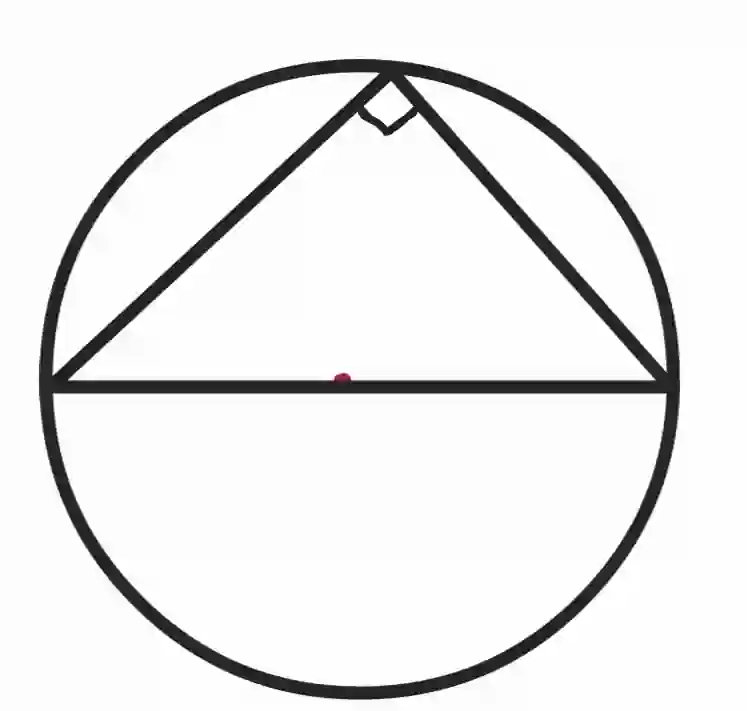

2. Angle between tangent and radius is always 90° and they are perpendicular to each other

   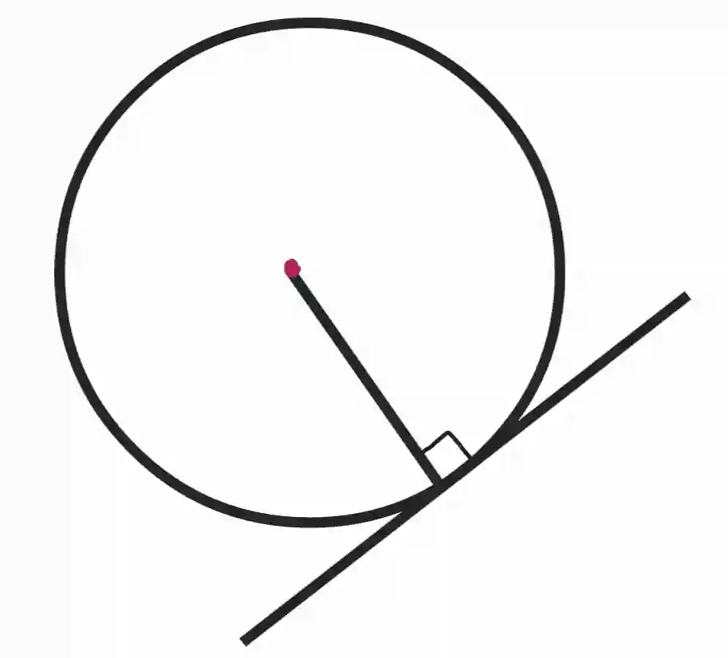

3. The angle at the center is twice the angle on the circumference

   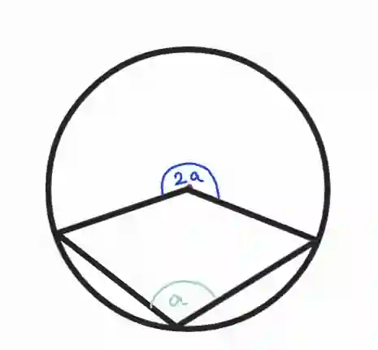

   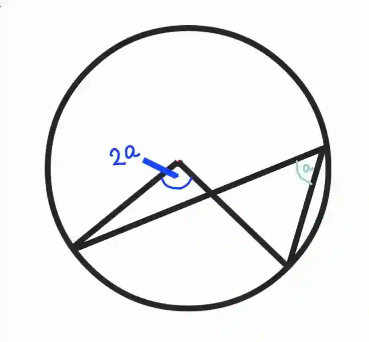

   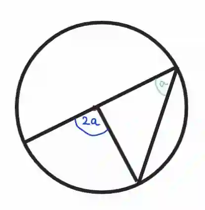

4. Triangle with two radiuses is isosceles

   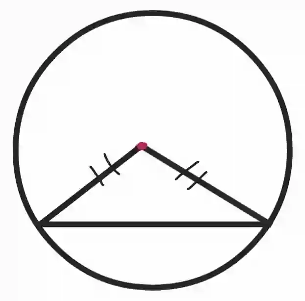

5. Two tangent lines from the same point are equal in length

   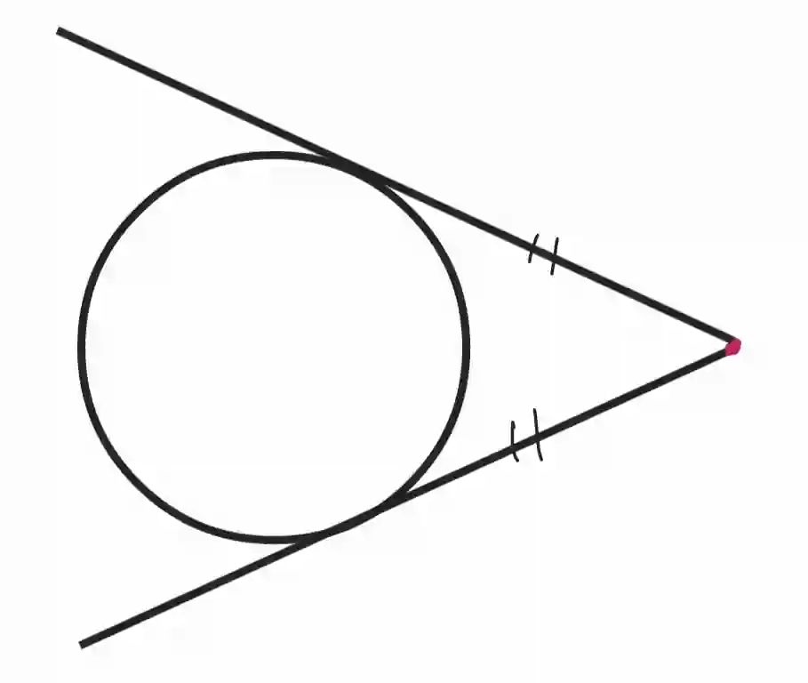

6. Two angles at the circumference of a circle that are formed from the same two points on the circumference are equal

   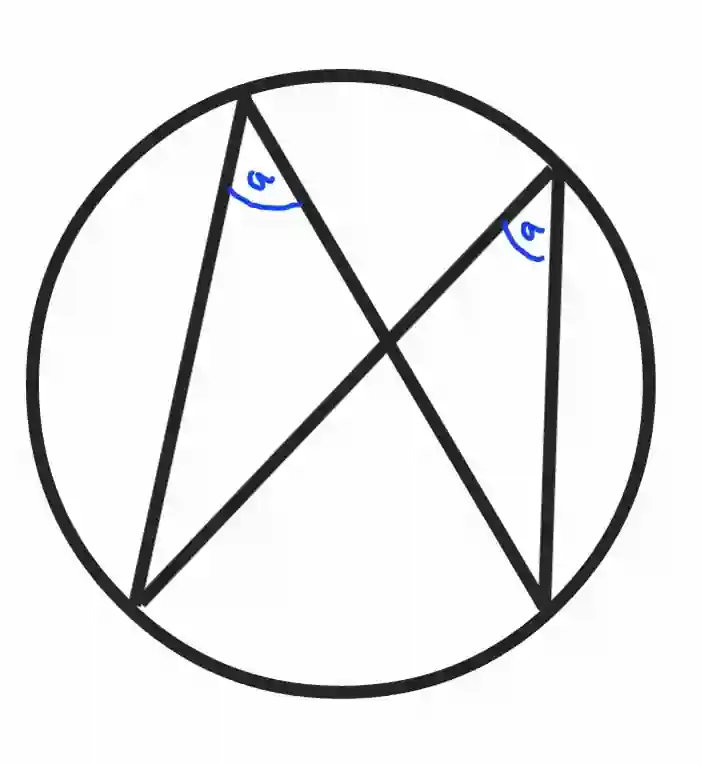

7. Opposite angles of a cyclic quadrilaterals add up to 180°

   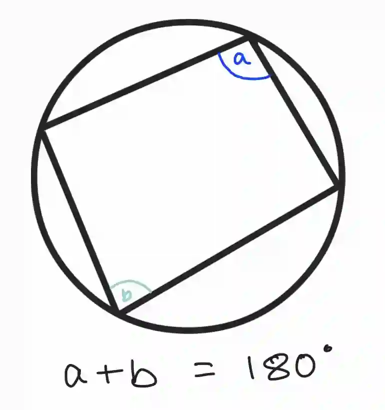

8. Angle between a chord and a tangent is equal to the angle in the alternate segment

   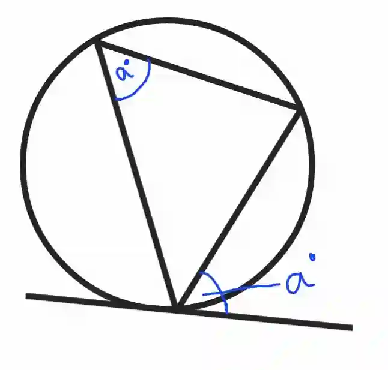

9. Chords equidistant from the center of a circle are always equal in length

   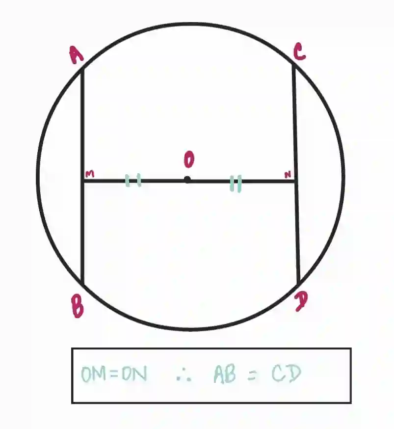