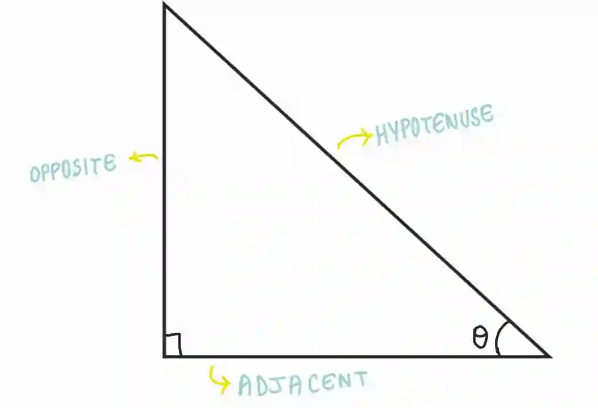
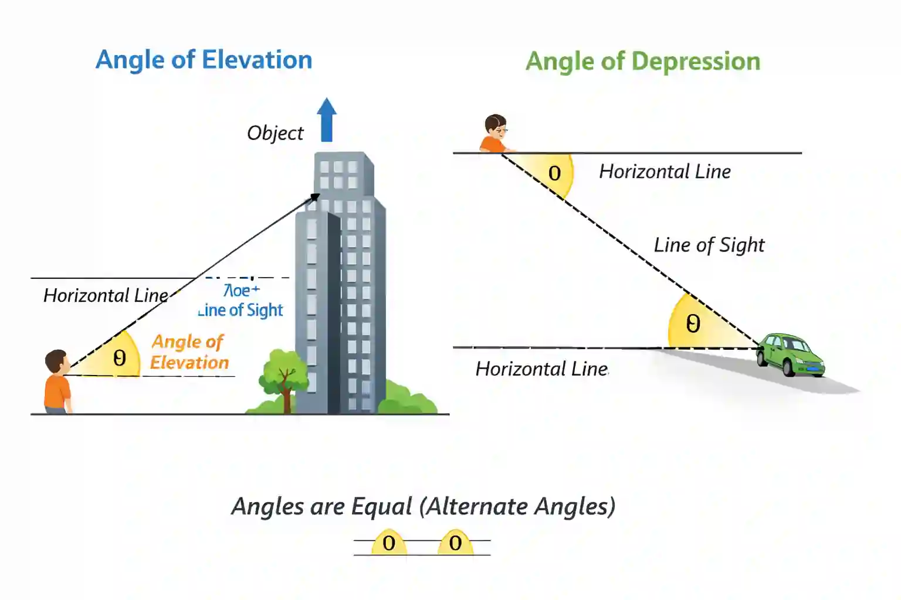

# Trigonometry

## Right-angled triangles

### **Pythagoras’ theorem**

$$
\boxed {a^2 + b^2 = c^2}
$$

**where $c$ is the longest side (hypotenuse) and $a$ and $b$ are the two shorter sides*

* Uses of the theorem:

  * to find the length of a missing side of a right-angled triangle

  * to find the distance of a chord from the centre of a circle

  * to find the distance between 2 points given on a grid

* The hypotenuse side is the longest side of a right-angle triangle, opposite to the 90°

* Remember, the perpendicular distance from a point to a line is the shortest distance to the line

* Hypotenuse: The longest side of a right-angled triangle (opposite to the right angle)

* Opposite: The side opposite the angle θ

* Adjacent: The side next to the angle θ (other than the hypotenuse)

### **Trigonometric ratios**

$$
\boxed {\sin(\theta) = \frac{\text{opposite side}}{\text{hypotenuse}}}

$$

$$

\boxed {\cos(\theta) = \frac{\text{adjacent side}}{\text{hypotenuse}}}

$$

$$

\boxed {tan(\theta) = \frac{\text{opposite side}}{\text{adjacent side}}}

$$

* Angles will be given in degrees, and answers should be written in degrees with answers correct to 1.d.p

### **Angle of elevation and depression**

* The angle of elevation is the angle between the horizontal line and the line of sight when looking up at an object

  * Example:
    Looking up at the top of a building from the ground

* The angle of depression is the angle between the horizontal line and the line of sight when looking down at an object

  * Example:
    Looking down at an object from the top of a building

  