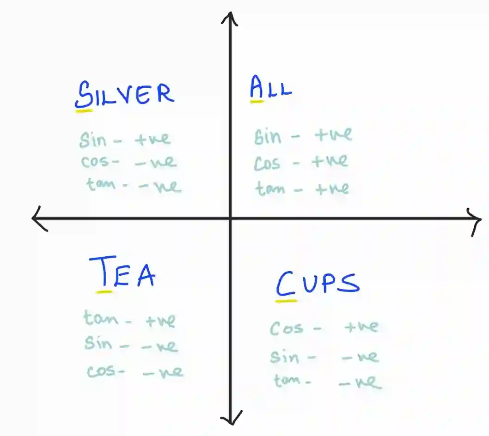
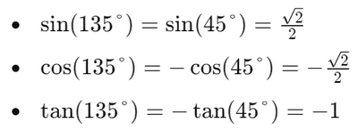

## **Trigonometric ratios in the four quadrants**

* Quadrant 1

  * Angles: $0° < θ < 90°$

  * All trigonometric ratios ($\sin$, $\cos$, $\tan$) are positive.

* Quadrant 2

  * Angles: $90° < θ < 180°$

  * $\sin(θ)$: Positive

  * $\cos(θ)$: Negative

  * $\tan(θ)$: Negative

* Quadrant 3

  * Angles: $180° < θ < 270°$

  * $\sin(θ)$: Negative

  * $\cos(θ)$: Negative

  * $\tan(θ)$: Positive

* Quadrant 4

  * Angles: $270° < θ < 360°$

  * $\sin(θ)$: Negative

  * $\cos(θ)$: Positive

  * $\tan(θ)$: Negative

Remember the signs with the mnemonic '‘**all silver tea cups**’’

* In the first quadrant, all ratios are positive

* In the second quadrant, only $\sin$ is positive (Silver)

* The third quadrant only $\tan$ is positive (Tea)

* Fourth quadrant only $\cos$ is positive (Cups)

### **Reference Angles**

Once the reference angle is found, calculate the trigonometric value and apply the correct sign based on the quadrant

* Quadrant I: Reference angle = $θ$

* Quadrant II: Reference angle = $180°−θ$

* Quadrant III: Reference angle = $θ−180°$

* Quadrant IV: Reference angle= $360°−θ$

### **Example:**

1. Solve Sin(135°), Cos(135°),tan(135°)

   * Reference angle: 180°−135°=45°

     * Quadrant II: Sine is positive, Cosine and Tangent are negative

       

2. Solve $\tan x = \sqrt{3}$ for $

   * $x = 60^\circ$

   * $tan x > 0$ $\Rightarrow$  At quadrant I and III

   * $$x = 60^\circ$$

     $$x = 180^\circ + 60^\circ = 240^\circ$$

   * Final answers =$x = 60^\circ, 240^\circ$

3. Solve $4(\cos x)^2 - 4\cos x - 3 = 0, \quad 0^\circ \le x \le 360^\circ$

   * Let  y = cos x

     * $4y^2 - 4y - 3 = 0$

   * Solve the quadratic

     * $(2y + 1)(2y - 3) = 0$

     * $2y + 1 = 0 \Rightarrow y = -\frac{1}{2}$

     * $2y - 3 = 0 \Rightarrow y = \frac{3}{2}$

   * Check if they are valid

     * $$\cos x = \frac{3}{2} \quad \text{(invalid, since } -1 \le \cos x \le 1\text{)}$$

   * $\therefore$ Solve for the valid equation $\cos x = -\frac{1}{2}$

     * Reference angle: $ 60^\circ$

     * Cos negative → Quadrant II and III

     * $x = 180^\circ - 60^\circ = 120^\circ$

     * $x = 180^\circ + 60^\circ = 240^\circ$

   * Final answer : $x = 120^\circ, 240^\circ$