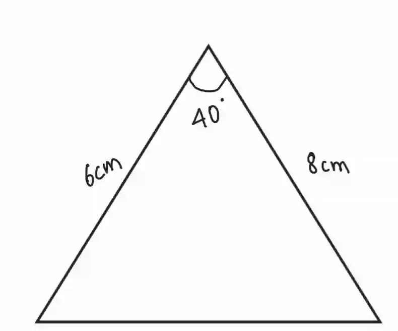
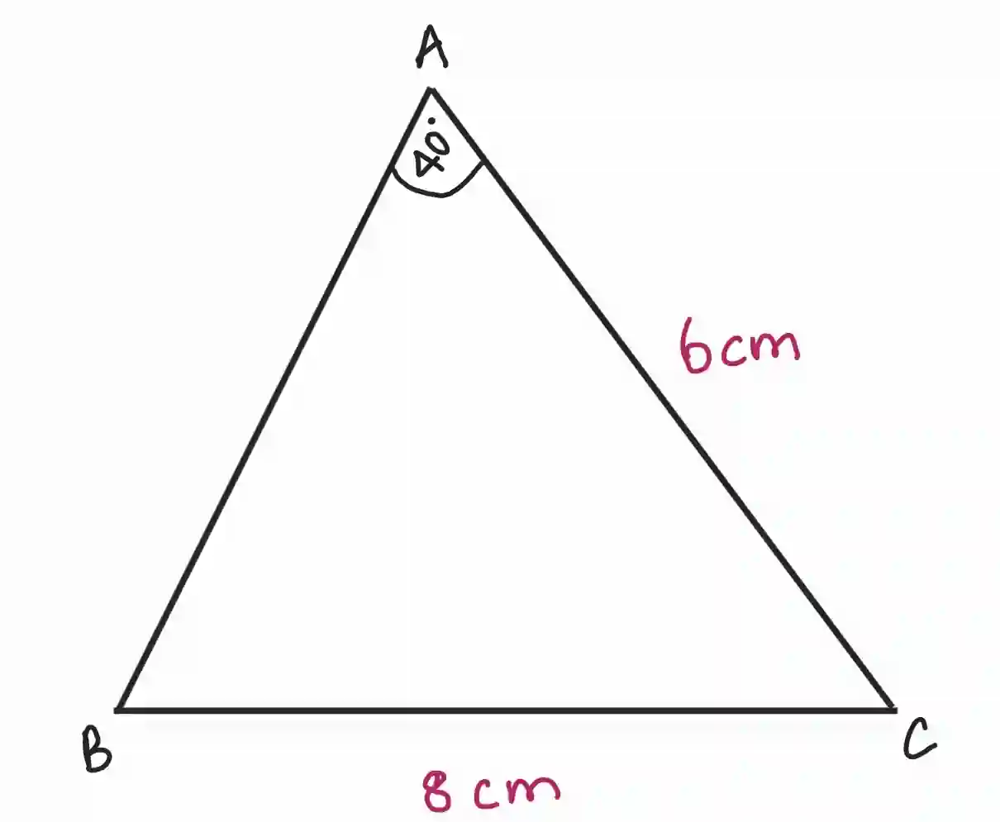
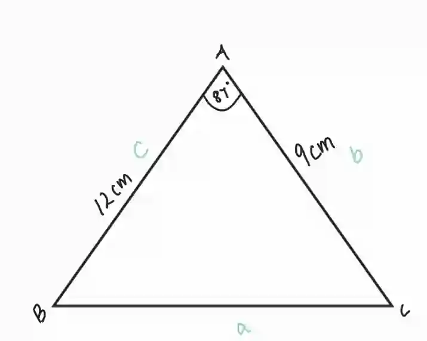

## Non-right-angled triangles

Formula :

$$

\boxed {\text{Area of triangle} = \dfrac{1}{2} ab\sin C}

$$

Used when :

* Two sides and the included angle are known

* The triangle is a non-right angle triangle

* $a$ and $b$ are the lengths of two sides and $C$ is the included angle

**Note: This formula and method works for all triangles, not just right-angled ones*

Example: Find the area of a triangle, with length 6cm and 8 cm and included angle 40°

$\quad =\frac{1}{2} \times 8 \times 6 \times \sin(40)$

$\quad = 15.42690 \approx 15.4 cm^2$

### **Sine rule**

* For any triangle ABC with sides a, b, and c opposite angles A, B, and C respectively, the Sine Rule states:

  $$
  \boxed {\dfrac{a}{\sin(A)} = \dfrac{b}{\sin(B)} = \dfrac{c}{\sin(C)}}
  $$

* Example:

  * Triangle ABC has sides with length: a=8 cm, b=6 cm. Angle A has 40° find angle B

    

    * $\dfrac{a}{\sin(A)} = \dfrac{b}{\sin(B)} $

    * $\dfrac{8}{\sin(40)} = \dfrac{6}{\sin(B)} $

    * $\sin(B) = \dfrac{6\cdot \sin 40}{8}$

    * $\angle B = \sin^{-1} (0.4821) \approx 28.9$

### **Cosine rule**

* When you know two sides and the included angle (SAS), you can use the Cosine Rule to find the unknown side length

$$

a^2 = b^2 + c^2  -2bc\cos(A)

$$

* Example: Find length of BC

  

  $\quad a^2 = b^2 + c^2  -2bc\cos(A)$

  $\quad a^2 =9^2 + 12^2  -2bc\cos(87)$

  $\quad a^2 = 81 + 144 - 216 \times 0.05$

  $\quad a^2 = 225-11.3$

  $\quad a=\sqrt{213.7}$

  $\quad a \approx 14.62 cm $