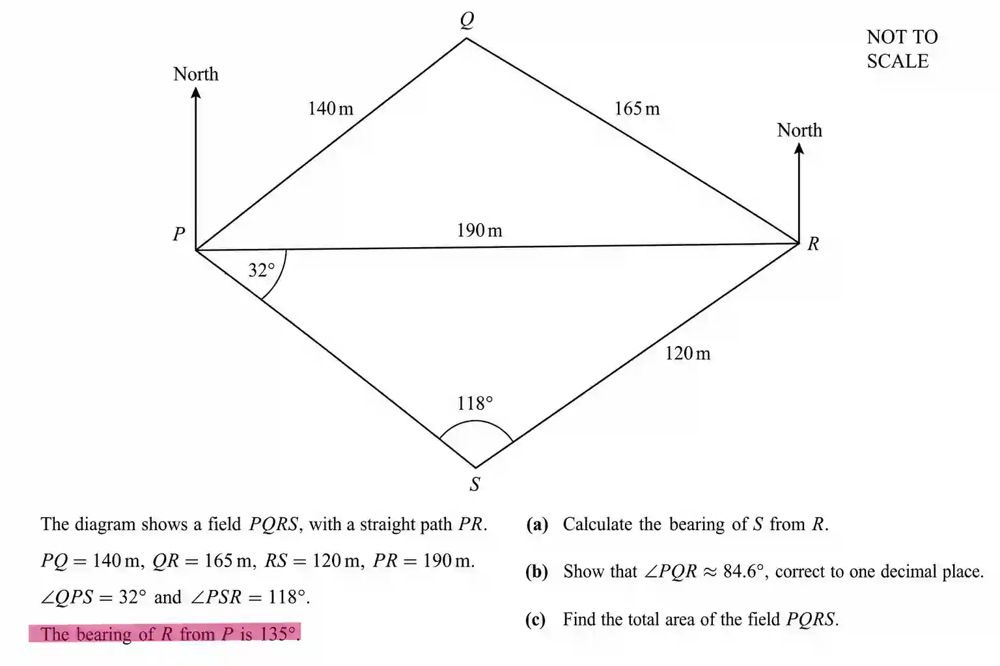

## Solving questions involving trigonometry

In past papers we don’t just use one concept but a series of concepts like sine rule , cos rule , angles ,pythagorean theorems and many more mathematical concepts to solve a question .

a) Bearing of $S$ from $R$}

* $\angle PRS = 180^\circ - (32^\circ + 118^\circ) = 30^\circ$

* $\text{Bearing of } P \text{ from } R = 135^\circ + 180^\circ = 315^\circ$

  * pic of the alt 

* So, Bearing of S from R = $315^\circ - 30^\circ = 285^\circ$

* $$
  \boxed{285^\circ}
  $$

b) Show that $\angle PQR \approx 84.6^\circ$}

* We can use cosine rule in $\triangle PQR$ to find the angle directly 

  * $PR^2 = PQ^2 + QR^2 - 2(PQ)(QR)\cos \angle PQR$

  * $190^2 = 140^2 + 165^2 - 2(140)(165)\cos \angle PQR$

  * $36100 = 19600 + 27225 - 46200\cos \angle PQR$

  * $36100 = 46825 - 46200\cos \angle PQR$

  * $46200\cos \angle PQR = 10725$

  * $\cos \angle PQR = \frac{10725}{46200}$

  * $\cos \angle PQR \approx 0.232$

  * $\angle PQR \approx \cos^{-1}(0.232) = 84.6^\circ$

* $$
  \boxed{84.6^\circ}
  $$

c) Total Area of $PQRS$

Area of field = Area of triangle PQR + Area of triangle PRS

* Area of $\triangle PQR$:

  * Area = $\frac{1}{2}ab\sin C$

  * $\frac{1}{2}(140)(165)\sin(84.6^\circ)

  * $= 11550 \sin(84.6^\circ)$

  * $\sin(84.6^\circ) \approx 0.995$

  * $\text{Area} \approx 11550 \times 0.995 = 11492$

* Area of $\triangle PRS$:

  * $\text{Area} = \frac{1}{2}(PR)(RS)\sin(\angle PRS)$

  * $= \frac{1}{2}(190)(120)\sin(30^\circ)$

  * $= \frac{1}{2}(190)(120)(0.5)$

  * $= 5700$

* Total Area $= 11492 + 5700$

  * $= 17192 \text{ m}^2$

* $$
  \boxed{17192 \text{ m}^2}
  $$