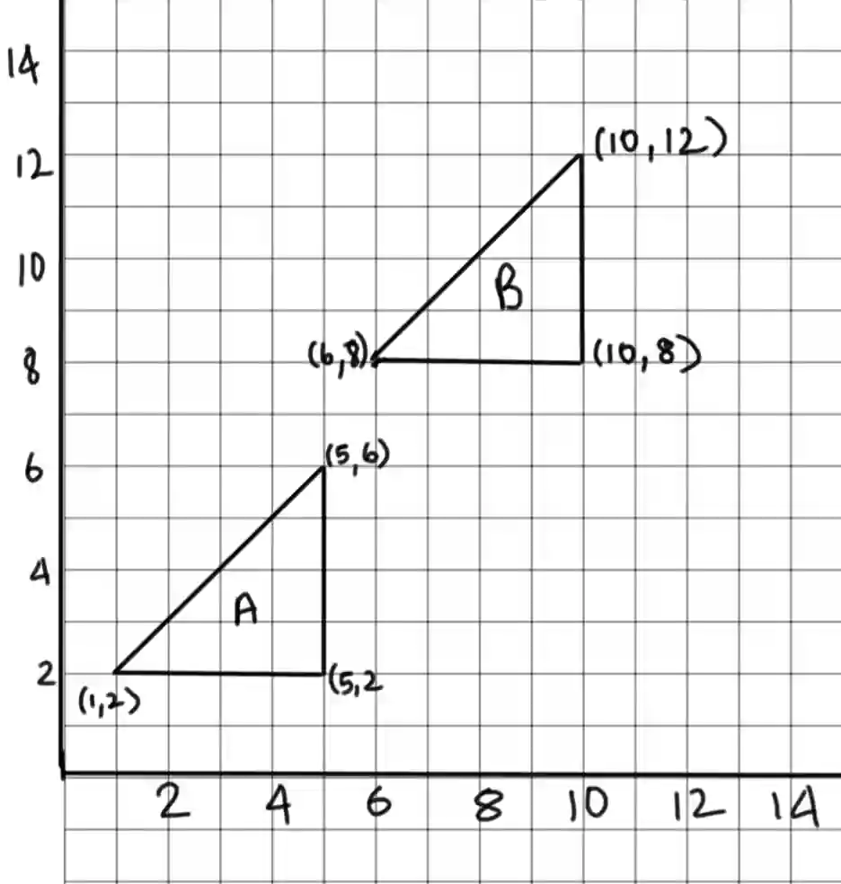

# Transformations and vectors

## Transformations

* Transformations change the position or size of a shape in a coordinate plane

* There are four main types of transformations:

  * Translation

  * Reflection

  * Rotation

  * Enlargement

### **Translation**

* Moves every point of a figure the same distance in the same direction

* Can be done using a column vector:

$$
\begin{pmatrix} x \\\ y \end{pmatrix}
$$

#|
||

$\quad$

|

$x$

|

$y$

||
||

movement direction

|

horizontal (left and right)

|

vertical (up and down)

||
||

($+$) sign

|

right

|

up

||
||

($-$) sign

|

left

|

down

||
|#

* $x$ is the distance moved horizontally (right or left),

  * a positive sign is right

  * a negative sign is left

* $y$ is the distance moved vertically (up or down),

  * a positive sign is up

  * a negative sign is down

* Add the column vector to each vertex to find the translated position

* When describing the transformation:

  * State that it’s a translation

  * State the column vector of the movement

* Example: Translate figure A to the column vector and label it B

  * Column vector :$$\begin{pmatrix} 5 \\\ 6 \end{pmatrix}$$

### **Reflection**

* Flipping a shape over the axis of reflection (mirror line) to create a mirror image

* Each point and its image are the same perpendicular distance from the mirror line

* When describing the transformation:

  * State that it’s a reflection

  * State the axis of reflection

* Common lines of reflection are:

  * $x\text{-axis: } \begin{pmatrix} x \\\ y \end{pmatrix} \rightarrow \begin{pmatrix} x \\\ -y \end{pmatrix}$

  * $y\text{-axis: } \begin{pmatrix} x \\\ y \end{pmatrix} \rightarrow \begin{pmatrix} -x \\\ y \end{pmatrix}$

  * $y = x:\ \begin{pmatrix} x \\\ y \end{pmatrix} \rightarrow \begin{pmatrix} y \\\ x \end{pmatrix}$

  * $y = -x:\ \begin{pmatrix} x \\\ y \end{pmatrix} \rightarrow \begin{pmatrix} -y \\\ -x \end{pmatrix}$

* Example: Reflect figure $A$ with a mirror line $y=x$

  

### **Rotation**

* Turning a shape around a fixed point (center of rotation) by a certain angle

* Each point stays the same distance from the center of rotation

* To rotate a figure in the graph make use of trace paper,

  1. Place the tracing paper over the image and draw over the original figure

  2. Place the tip of your pencil on the center of rotation

  3. Rotate the tracing paper the angle that has been stated in the question

  4. And draw the rotated figure on the graph

* When stating the transformation

  * State that it’s a rotation

  * State the center of rotation

  * State the angle of rotation

  * State the direction of rotation (anti-clockwise or clockwise)

\**Direction not required if the angle of rotation is 180$\degree$*

* Example: Rotate the shape $A$ 90° clockwise about the point $(-4,0)$

  

### **Enlargement**

* Resizing a shape by a scale factor, centered at a specific point

* If K $>$ 0, both object and image lie on same side of the center of enlargement

* If K $<$ 0, object and image lie on opposite side of the center of enlargement, produce a inverted image

* When describing the transformation:

  * State that it’s an enlargement

  * State the scale factor

  * State the center of enlargement

* To enlarge a image on the graph:

  1. From the center of enlargement count the horizontal and vertical distances to one vertex on the image

  2. Multiply the distances by the scale factor

  3. From the center of enlargement point measure the new distances and plot the position on the grid of the corresponding vertex

  4. Repeat this for all vertexes

* To find center of enlargement given the figures :

  1. Choose a point on the original figure and its corresponding point on the enlarged figure.

  2. Draw a straight line joining these two points.

  3. Repeat for another pair of corresponding points.

  4. The point where the two lines intersect is the centre of enlargement

* Example: Enlarge the image by the scale factor of 2 with a center point $(0,-2)$

  

Remember:

* Questions may involve combination of transformations, so always go by the order that was mentioned in the question

* Questions may involve reverse of transformations, so be careful when working backwards

* Make sure to use a ruler to draw all straight lines and edges in the shapes