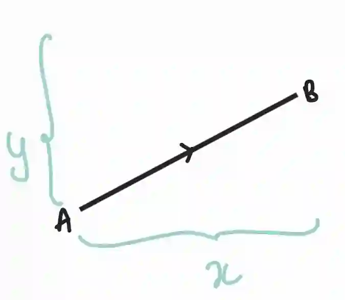

## Vectors

* A quantity that has both magnitude and direction.

* A vector from point $A$ to point $B$ is denoted as $\vec{AB}$

* Vector can also be represented as ‘**a’**

* Vector notion:

  $$\begin{pmatrix} x \\ y \end{pmatrix}$$

* Where x and y are the horizontal and vertical components, respectively

  