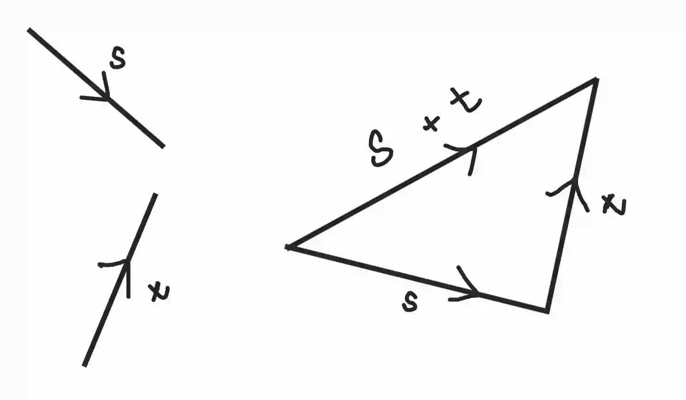
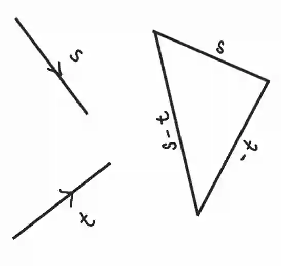
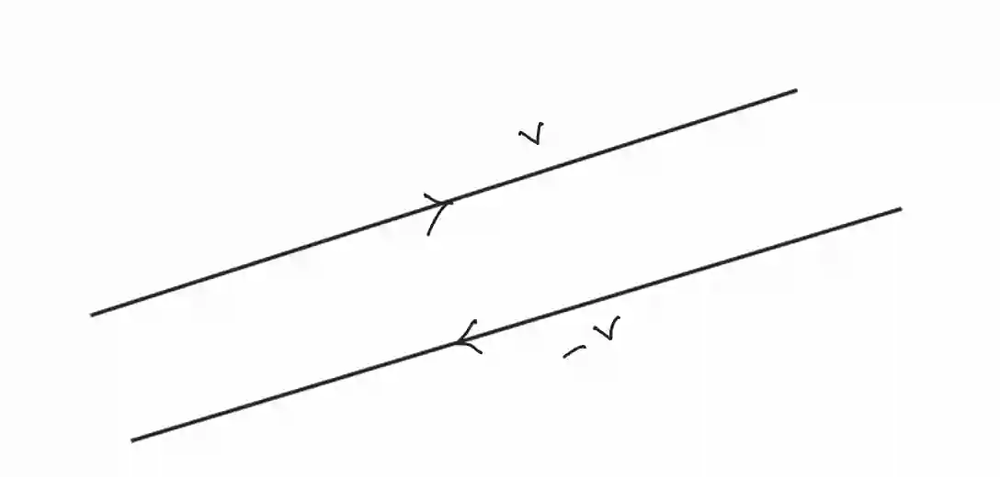

## Vector operations

### Addition and subtraction of vectors

* To add/subtract vectors, add/subtract their corresponding components

* Example 1: Add the vectors **s** and **t**

  * **s =** $$\begin{pmatrix} a \\\ b \end{pmatrix}$$, **t =** $$\begin{pmatrix} c \\\ d \end{pmatrix}$$ , **s**\+**t =** $$\begin{pmatrix} a+c \\\ b+d \end{pmatrix}$$

* Example 2: Subtract vectors the **s** and **t**

  * **s =** $$\begin{pmatrix} a \\\ b \end{pmatrix}$$, **t =** $$\begin{pmatrix} c \\\ d \end{pmatrix}$$ , **s**-**t =** $$\begin{pmatrix} a-c\\\ b-d \end{pmatrix}$$

### **Negative vectors**

* The negative of a vector is a vector that has the same magnitude (length) but points in the opposite direction

  

* **v** and −**v** are exactly in opposite directions

### **Multiplication of a vector by a scalar**

* Multiplying a vector by a scalar value changes its magnitude but not its direction

* Example: multiply vector **x** **=** $$\begin{pmatrix} 2 \\\ 3 \end{pmatrix}$$, by 4

  * $ 4x =4 \begin{pmatrix} 2 \\\ 3 \end{pmatrix}  = \begin{pmatrix} 4\cdot 2 \\\ 4\cdot 3 \end{pmatrix} = \begin{pmatrix} 8 \\\ 12 \end{pmatrix}$