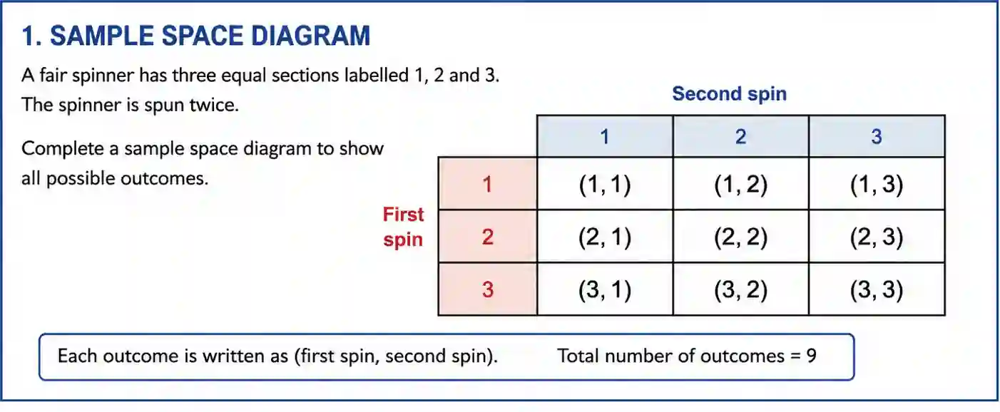
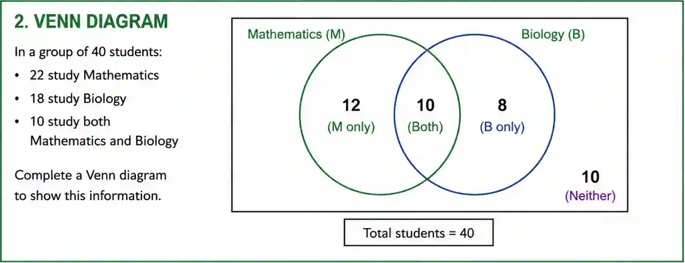

## Questions involving sample spaces and Venn diagrams

1. A fair spinner has three equal sections labelled 1, 2 and 3. The spinner is spun twice.

   a) Complete a sample space diagram to show all possible outcomes

   

   b) Find the probability that the sum of the two numbers is 4

   * Total outcomes = 9

   * Outcomes that give sum = 4 are :

     * $(3,1), (2,2),(1,3)$ ------ 3 outcomes give sum = 4

   * $\therefore$ probability that the sum of the two numbers is 4 = $\frac{3}{9}$ = $\frac{1}{3}$

   c) Find the probability that both numbers are the same

   * Favourable outcomes: $(1,1), (2,2), (3,3)$

   * $\therefore$ probability that both numbers are the same = $\frac{3}{9}$ = ${1}{3}$

2. In a group of 40 students: 22 study Mathematics 18 study Biology 10 study both Mathematics and Biology

   a) Complete a Venn diagram to show this information

   * Mathematics only = $22 - 10 = 12$

   * Biology only =$18-10 = 8$

   * Neither = $ 40-(12+10+8) = 10$

b) One student is chosen at random. Find the probability that the student studies:

i. Mathematics or Biology

* P(M $\cup$ B)

* $= \frac{12 + 8 + 10}{40} = \frac{30}{40} = \frac{3}{4}$

ii. Biology only

* $P = \frac{8}{40} = \frac{1}{5}$