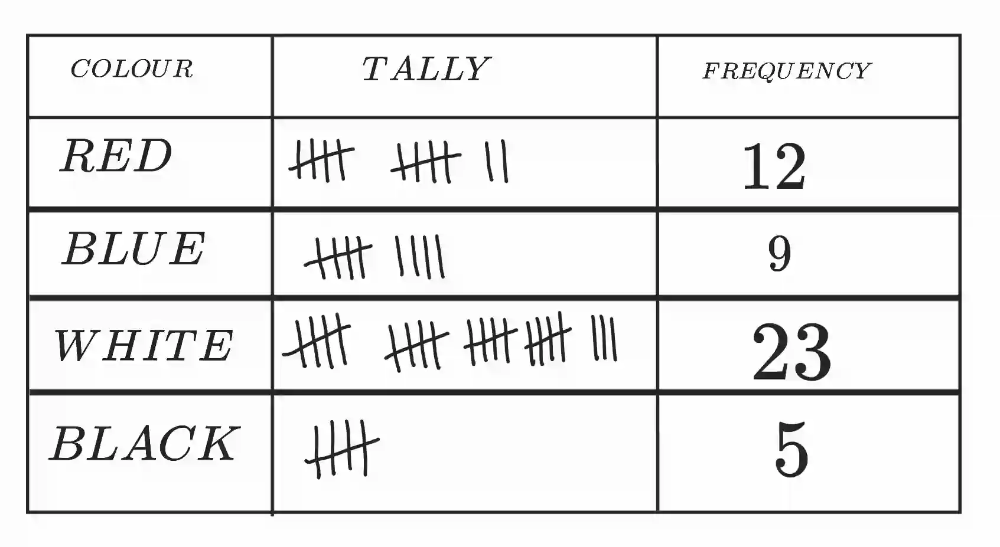
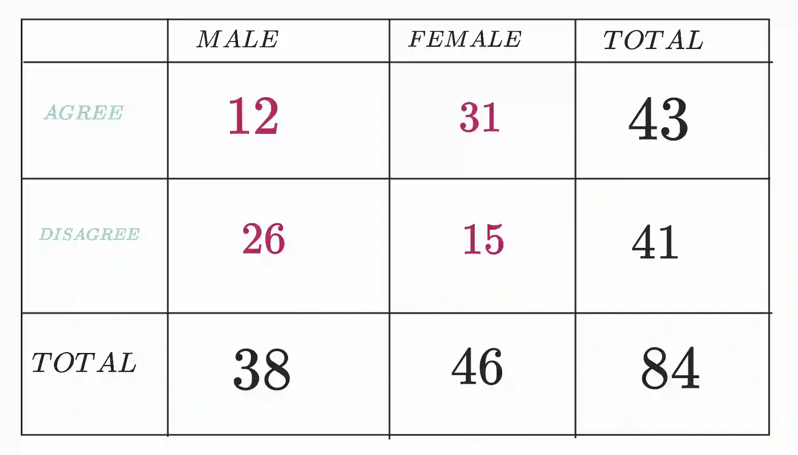

## **Classifying statistical data**

**Tally tables**

* A tally table is used to record and count data quickly using tally marks

* Tally Marks are used to represent the frequency

* Each tally mark represents **1**

* The **fifth tally** is drawn across the previous four

* Example :

  

**Two - way tables**

* A two-way table shows data classified by two different categories.

* Structure:

  * Rows represent one category

  * Columns represent another category

  * Totals are shown at the end of rows and columns

* Example:

  