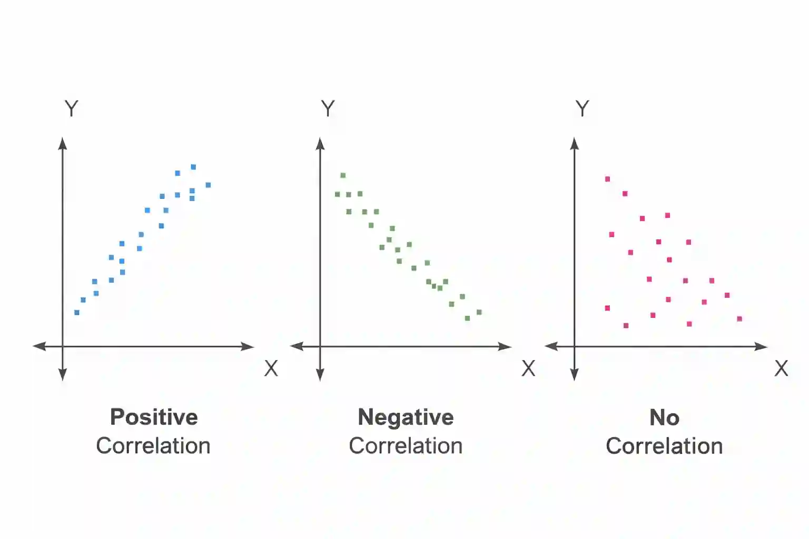

## Scatter diagrams

Shows the relationship between **two variables** by plotting pairs of values as points on a graph.

* Each point represents **one pair of data**

* No lines are joined between points

* **x-axis** → independent variable

* **y-axis** → dependent variable

Example:

* x-axis: hours studied

* y-axis: marks scored

**Types of Correlation**

### **1. Positive Correlation**

* As $x$ increases, $y$ increases

* Points slope upwards

### **2. Negative Correlation**

* As $x$ increases, $y$ decreases

* Points slope downwards

### **3. No Correlation**

* No clear pattern

* Points are scattered randomly

**Line of Best Fit**

* A straight line drawn to show the overall trend

* About half the points should lie on each side and there should be roughly a even distribution

* Used for prediction

* Should extend across the full data set

**Linear regression**

* Used to predict values of the scatter diagram

* Form : $y=ax +b$

### **Steps to Find the Regression Equation (GDC)**

Step 1: Enter STAT Mode

* Select STAT

* Choose 2-variable statistics

Step 2: Enter the Data

* Enter x-values in the x-column

* Enter y-values in the y-column

* Make sure values are paired correctly

Step 3: Select Linear Regression

* Go to CALC / REG

* Choose Linear (a + bx) or LinReg

The calculator displays values including:

* $a$ (gradient)

* $b$ (y-intercept)

* this can be used to write the linear equation in form $y=ax+b$