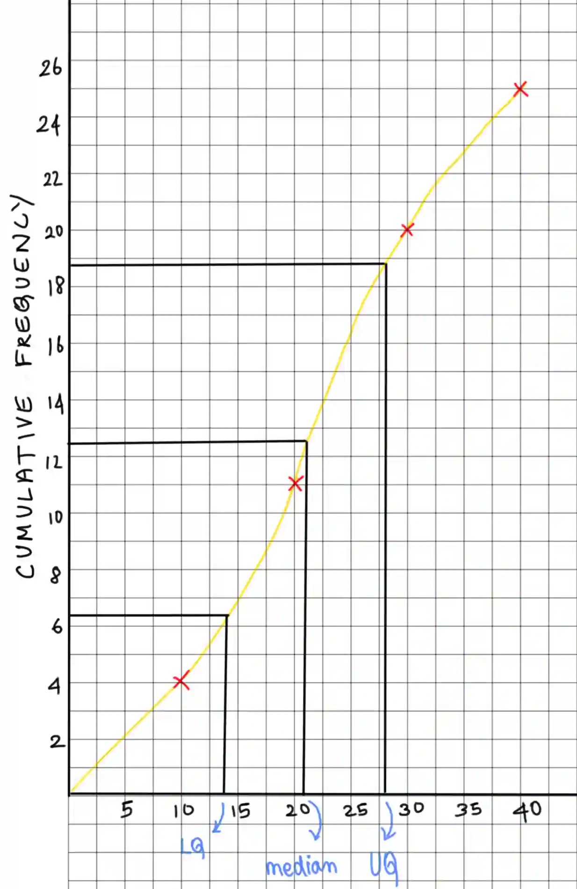

## Cumulative frequency tables and diagrams

**Cumulative frequency tables**

* Cumulative frequency is the **total frequency up to a given value**

* It shows how many observations are **less than or equal to** a certain value

* We can find the cumulative frequency of a table by adding the frequencies step by step

* Example :

  #|
  ||
  
  Class interval

  |
  
  Frequency

  |
  
  Cumulative frequency

  ||
  ||
  
  $0-10$

  |
  
  $4$

  |
  
  $4$

  ||
  ||
  
  $10-20$

  |
  
  $7$

  |
  
  $11$

  ||
  ||
  
  $20-30$

  |
  
  $9$

  |
  
  $20$

  ||
  ||
  
  $30-40$

  |
  
  $5$

  |
  
  $25$

  ||
  |#
  

**Cumulative frequency diagrams**

* Usually a sigmoid curve

* x axis: Upper class boundary

* y axis: Cumulative frequency

* Points should be clearly marked with small crosses

* Join the points to form a smooth curve

* Remember,

  * the graph always increases

  * The last point gives the total frequency

  * The curve is smooth, not joined by straight lines

* Finding statistical data using cumulative frequency graphs :

  * Median : Is the 50% of the cumulative frequency

    * Draw a horizontal line from the 50% of cumulative frequency to the curve

    * Drop the line towards  the x- axis

  * Lower quartile : is the 25th % of the cumulative frequency

    * Draw a horizontal line from the 25th% of cumulative frequency to the curve

    * Drop the line towards  the x-axis

  * Upper quartile : Is the 75th % of the cumulative frequency

    * Draw a horizontal line from the 25th% of cumulative frequency to the curve

    * Drop the line towards the x- axis

* Example: 

  * Median : $\frac{25}{2} = 12.5  \text{ on y-axis} \approx 21$

  * LQ: $\frac{25}{4} = 6.25  \text{ on y-axis} \approx 13$

  * UQ: $\frac{25\cdot 3}{4} = 18.75  \text { on y-axis} \approx 28$