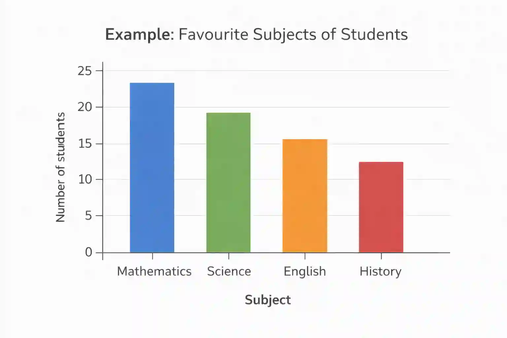
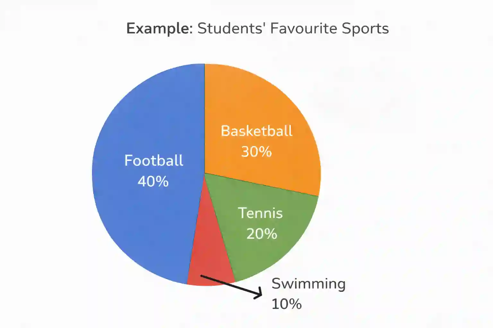
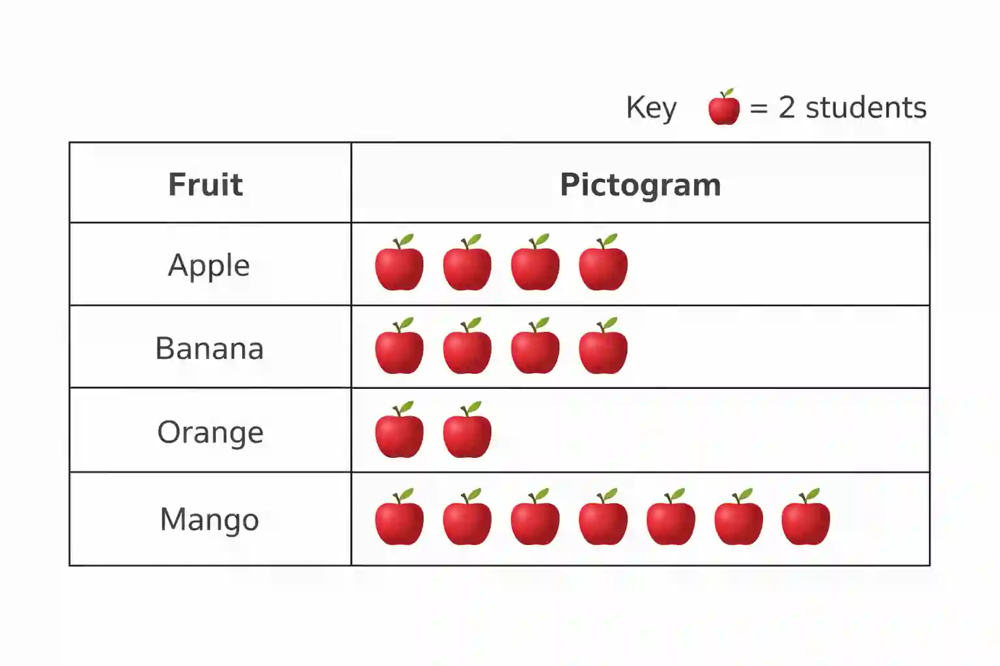
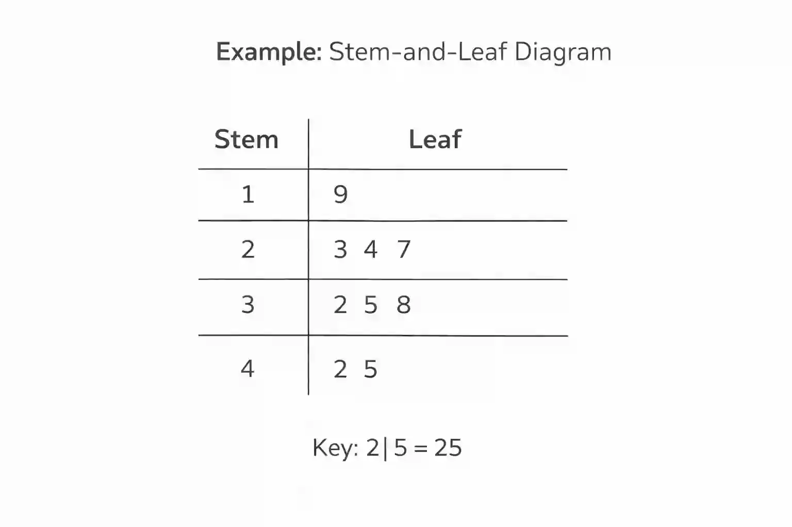
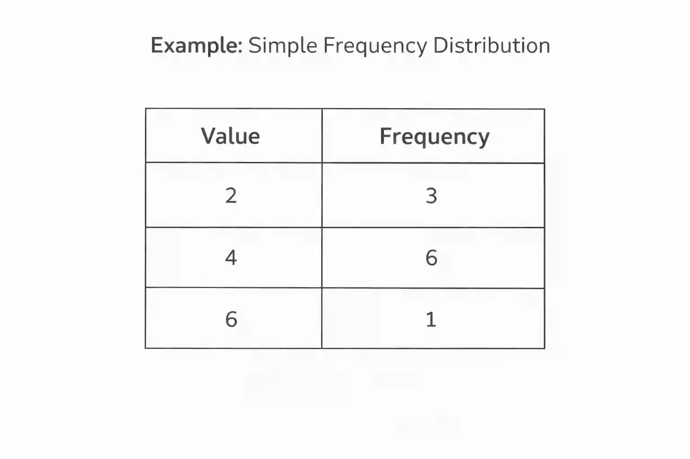

## Statistical charts and diagrams

**1.Bar charts**

* uses rectangular bars to show frequencies of discrete or categorical data

* Drawing a bar chart :

  * x-axis → categories

  * y- axis → frequency

  * Bars must:

    * Have equal width

    * Have gaps between them

  * Draw bars to correct heights(frequency) as specified by the question

* Tallest bar represents the highest frequency

* The height of a bar chart is used to compare data

* Bar charts may be stacked one on to of the other , so be careful when drawing and comparing the data

* Example :

  

**2.Pie charts**

* A pie chart shows how a whole data is divided into parts and categorized

* $\text{Sector angle} = \frac{frequency }{total}\times 360$

* Drawing a pie chart :

  * Calculate each sector angle

  * Draw a circle

  * Use a protractor to draw angles

  * Label each sector

* Larger sector represents a larger proportion

* Used to compare angles visually

* Remember , the total angle in a pie chart should add up to 360

* Example:

  

**3.Pictogram**

* uses pictures or symbols to represent data

* A key must be given

* A symbol may represent more than one item

* Partial symbols may be used

* We can interpret the data by counting symbols using the key

* Include fractions if shown

* Example:

  

**4.Stem-and- leaf diagram**

* displays data while keeping the original values

* **Stem** → first digit(s)

* **Leaf** → last digit

* Arrange data in order

* Write stems in a column

* Write leaves in ascending order

* should have a key

* Can find mean, median, IQR, UQ ,LQ

* Example: 

  

**5.Simple frequency distribution**

* Table showing values and how often they occur

* Organising raw data

* Used to draw charts

* Finding averages

* Example : 