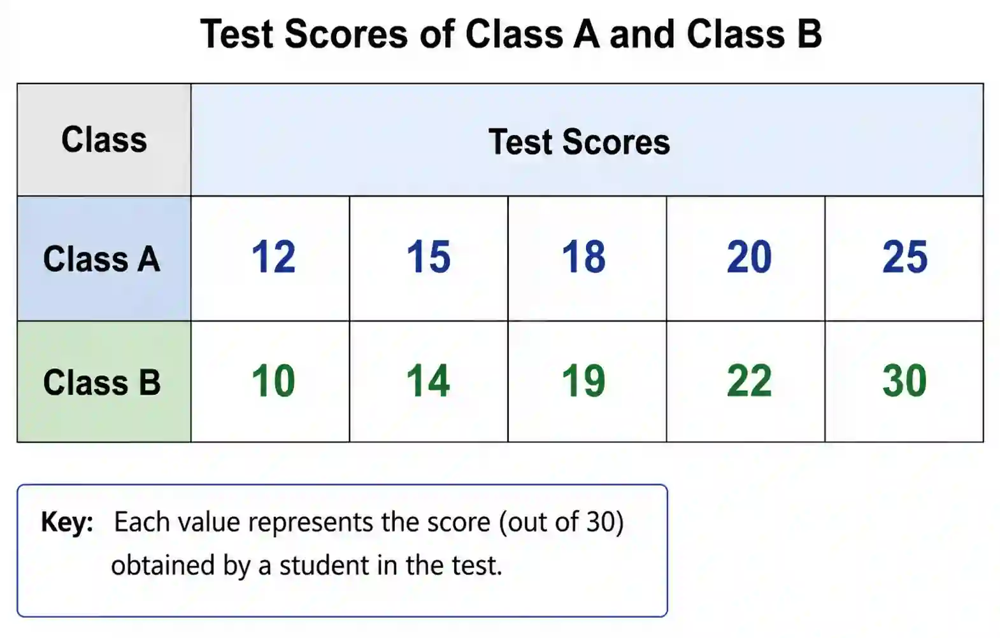

## Data interpretation 

### Mean 

* Average value of a data set 

* Denotes overall performance 

* Affected by extreme values (outliers)

* Best to compare data sets when they don’t have extreme values (outliers) 

### Median 

* Central position of data

* Can be used to compare data sets when it has outliers 

### Mode 

* Most common outcome , value that occurs the most 

* Can be used to compare categorical data 

### Range 

* Shows overall spread 

* Can be used to compare how varied different data sets are 

* Is unreliable as it uses only 2 values 

### IQR

* Shows the spread of the middle $50%$ of data 

* They are  not affected much by outliers 

* More reliable than range 

### Bias and Sample size 

**Bias** is unfair or unrepresentative data collection

Types of Bias : 

* Selection bias → wrong group chosen

* Question bias → leading questions

* Non-response bias → people don’t respond

**Sample size** is the number of observations taken 

* Larger sample size is more reliable than a smaller sample size

### Examples : 

1. The test scores of two classes are shown below:

   

   a. Find the mean and range for each class

   * Class A:
     
     Mean = $\frac{12 + 15 + 18 + 20 + 25}{5} = \frac{90}{5} = 18$
     
     Range = $25 - 12 = 13$

   * Class B:
     
     Mean= $\frac{10 + 14 + 19 + 22 + 30}{5} = \frac{95}{5} = 19$
     
     Range = $30 - 10 = 20$

   b. Compare the performance of the two classes

   * Class B has a higher mean, so performs better on average

   * However, Class B has a larger range, so results are more spread out (less consistent)

   * Class A is more consistent

2. A survey of 20 students shows that $80%$ prefer online learning. Explain why this result may not be reliable

   * Small sample size (only 20 students)

   *  Data set may not represent all students

   *  Possible bias in selection

   * Results may not apply to other group