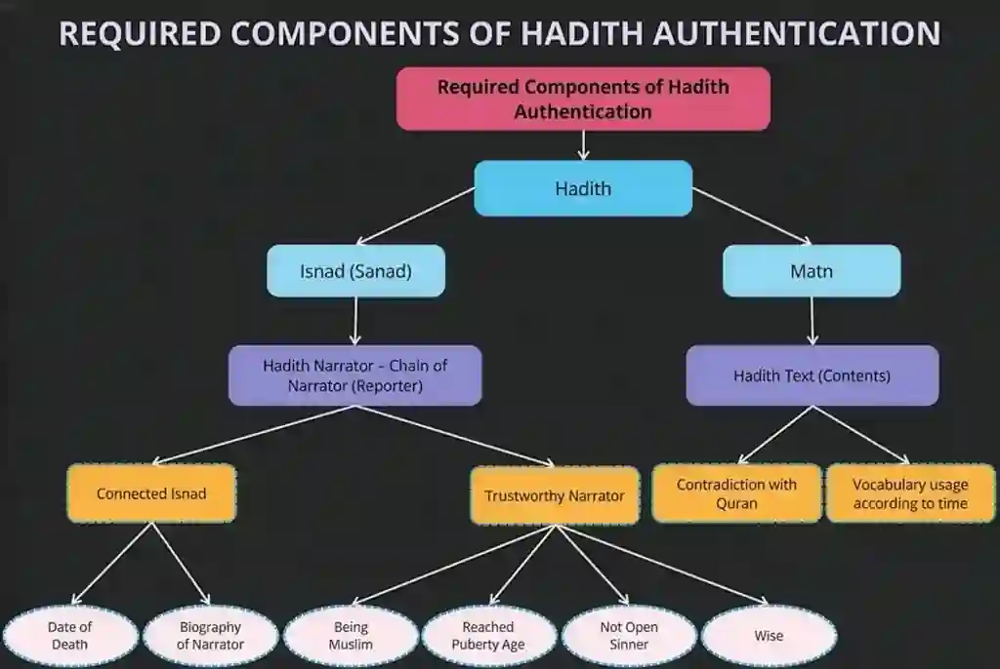
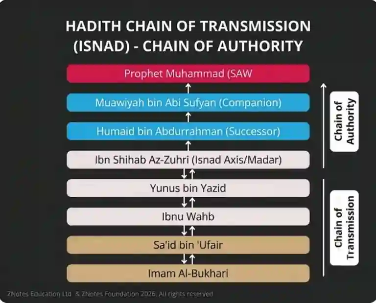

## Components of Hadith

**Isnad & Matn**

Every Hadith consists of two essential parts: the **Isnad** and the **Matn**. Both parts must be evaluated together to determine the overall authenticity of a Hadith.

#|
||

Components

|

Definition

|

Core Focus

||
||

Isnad

|

The chain of narrators who transmitted the Hadith.

|

Lists every person from the Prophet (PBUH) down to the final collector.

||
||

Matn

|

The actual text, speech, or content of the Hadith itself.

|

Reports the exact words, actions, or approvals of the Prophet (PBUH).

||
|#

**Rules of Isnad (Asma-ur-Rijal)**

The chain of narrators is verified using a specialized science called **Asma-ur-Rijal**. To be considered authentic, the transmitters must meet these criteria:

1. The first transmitter in the chain must be a **Companion (Sahabi)** of the Prophet (PBUH).

2. All transmitters must be **sane, adult Muslims**.

3. A transmitter must **not have committed any major sin**.

4. The transmitter must possess a **sound and reliable memory**.

5. There must be **no generational gaps** between consecutive transmitters in the chain.

6. The transmitter must be capable of recalling the entire chain back to the Prophet (PBUH).

7. The transmitter must have a **good command of the Arabic language**.

**Scholarly Quote:** Abdullah ibn al-Mubarak said: *"The isnad is part of religion; if it were not for isnad, anyone could say whatever they wish."*

**Prophet’s Hadith:** “May Allah give freshness to a servant who hears me saying, memorizes it and communicates it.”

**Example of Isnad(Chain of Narrators):**

**Rules of Matn (Dirayat / Diryatayn)**

The actual text is checked using a set of rules known as **Dirayat**. The content must pass the following checks:

1. The Matn **must not contradict Quranic teachings**.

2. It **must not contradict other highly authentic** Ahadith.

3. It **must not** promise massive, disproportionate rewards or extreme punishments for simple, everyday human tasks.

4. It **should not use vulgar or bad language**.

5. It **must be written in pure Arabic**.

6. It **should not favour any tribe or race.**

7. It **should not predict the future** directly.

   Hazrat Ayesha(RA) said “If anyone says that the Messenger of Allah knew what would happen tomorrow, he is telling a lie”

8. It **should not be against the Prophet(PBUH) himself**.

**Example of Matn(Context of Hadith):**

“None of you believes until you want for your brother what you want for yourself”