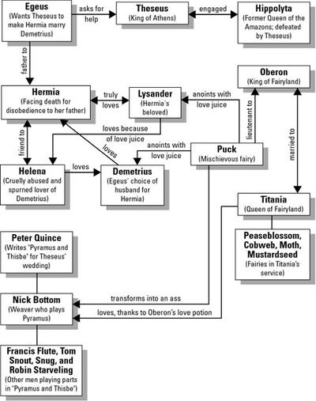

## Characters

1. **Puck / Robin Goodfellow**:
   * Serves the fairy king Oberon
   * Faithful but is also mischievous in many scenes of the play
   * Has many magical abilities \[ex. transforming people into other beings, such as turning Bottom into an ass\]
2. **Nick Bottom**:
   * A weaver and a part of the mechanicals’ play
   * A poor actor - doesn’t understand how to act and constantly makes long and unnecessary speeches
   * Foolish and self-important, but means well with his words and actions
3. **Hermia**:
   * Strong-willed - refuses to marry Demetrius and disobeys her father
   * Beautiful, with dark hair
   * Loyal to Lysander throughout the play, fierce when angry
4. **Helena**:
   * Has low esteem, often desperate for love and goes to great extents for it
   * Conniving and jealous, especially of her friend Hermia
   * Tall and blonde
5. **Lysander**:
   * An Athenian nobleman
   * Model of a constant lover, portrayed as charismatic and attractive
   * Defiant and stubborn, refusing to allow Demetrius to have Helena; instead, he plans their elopement 
6. **Demetrius**:
   * An Athenian nobleman
   * Sees himself as superior to everyone, and is cruel at first to Helena
   * Impulsive and indecisive, constantly changing whom he displays his affections towards
7. **Oberon**:
   * Willful and demands obedience, going to great extents in order to do so
   * Manipulative, often uses magic to his own advantage \[ex. when dealing with Titania\]
   * Does have a more sensitive side, as he does feel guilty occasionally 
8. **Titania**:
   * Strong-willed \[ex. refusing to give the servant boy to her husband\]
   * Independent and powerful
   * Doting yet jealous when it comes to her partners
9. **Theseus**:
   * Husband of Hippolyta, whom he married after defeating her in battle
   * Strong, responsible, literal-minded
   * Fair as a leader to his people, as seen in the marriages of the four Athenians 

 