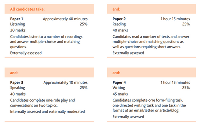
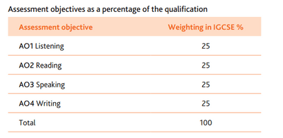

## Assessment Overview

In this course, all students must sit four papers to get a grade of (A* to G), and this test is usually available to be seated in the June/Summer Series only.

Here are the papers which are required for every student:

Paper 1: Listening

Paper 2: Reading

Paper 3: Speaking/Oral

Paper 4: Writing

**More Information can be found in this image below, sourced from the 2022-2024 Syllabus Guide:**  **The Weightage of this Qualification**  