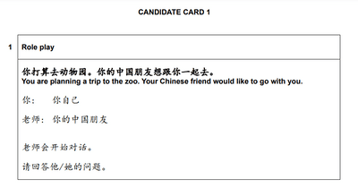
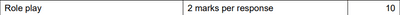
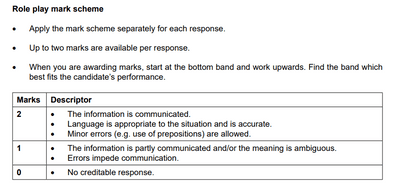

# Paper 3 (Oral Test)

The syllabus has changed since 2022, and students must do two sections this time: Section 1 is Role Play, and Section 2 is Topic Conversation. Cambridge wants students to use language in an applicable style rather than a memorization.

## Section 1 (第一部分)

This section is “Role Play”; it remains the same as in 2021 and before. There will be six different candidate cards where you will be yourself while your teacher will be someone else, e.g.,‎     

Your teacher asks you five questions regarding the topic, and you are given **approximately 10 minutes** to prepare to predict what the teacher will ask and answer them.

 

* In this example, they might ask you about:

Q1: “动物园今天几点开门？” (When does the zoo begin to open)

Q2: “我们怎么去？” (How do we get there?)

Q3: “我们带上午餐吧。你想吃什么？喝什么？” (We will go for lunch too. What would you like to eat and drink?)

Q4: “你上一次去动物园看到了哪些动物？” (From the last time, what animals did you see?)

*Questions 4 and 5 usually may have a sub-question/follow-up question. For example:

Q4a: “你觉得怎么样?” (What do you think about it?)

Q5: “去动物园以后，你想做什么?” (After going to the zoo, where do you want to go again?)

 

These are just examples of how questions are asked. (TIP: Your response should be short, concise and straight to the point.)

### Mark Scheme

**It is two marks per question in Role Play.**

The general mark scheme is applied to all role-play cards, and examiners should carefully mark it positively/awarded.