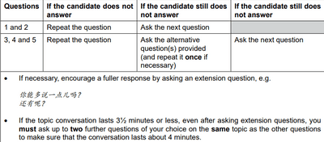

## Section 2 (第二部分)

* This section is “**Topic Conversation**”, where a random topic will be chosen from the List of Areas Tested in the Introduction Section, and students must speak for about 4 minutes minimum. Students are required to do TWO Topic Conversations.    
* Topics are varied from:
  * Clothes
  * Transportation
  * School
  * Favourite Subject
  * Environment & Nature
  * Famous Sites
  * Culture
  * Food
  * Technology & Communication
  * Friends and Family
  * Education and Training
* Your teacher will then ask you five questions about the topic you have presented, and the time should be managed equally to 4 minutes.

