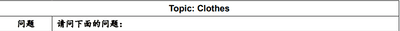
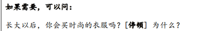
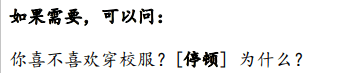
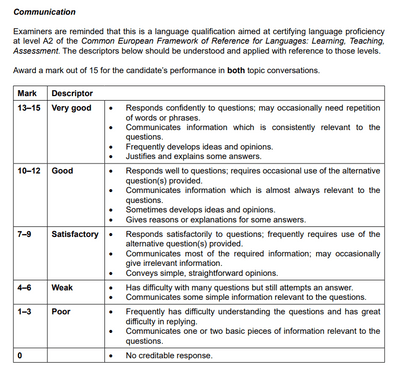
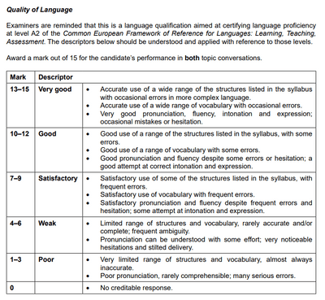

## Section 2 (第二部分) - Continued

Exemplar Questions are shown below for Topic Conversation A & B:

**Questions which may be asked:**

1. “在学校你一般穿什么衣服？” (What do you wear in school)

2. “请说说你最喜欢的一件衣服。” (Give a few details on your favourite piece of clothing)

3. “说说你上次买衣服的经历。比如，你买了什么？在哪儿买的？” (When did you last go shopping for clothes, and what did you buy?)

4. “长大以后买时尚的衣服对你重要吗？[停顿] 为什么？” (When you grow up, do you think the fashion trend is important, and why?)

   *[停顿] - It means pause; only examiners will do this action.

5. “你觉得穿校服有什么好处或者坏处？” (What are your thoughts on the advantages and disadvantages of wearing school uniforms?)

> Do note that if you struggle with these questions a few times, examiners will move on to ask the additional question section.   

---

### Mark Scheme

There will be two mark schemes in Topic Conversation, one assessing in language and another in Communication.

**Communication Mark Scheme:**   **Language Mark Scheme**  

(**Final Tip**: You are reminded to practice speaking the language fluently to secure the highest boundary of the mark descriptors; occasional English words during the speaking exam are acceptable.)