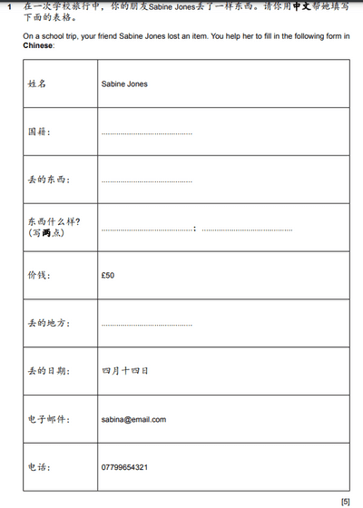

# Paper 4 (Writing)

## Question 1

In the new syllabus, Question 1 will no longer have a listing question; this time, it has shifted to fill in the blanks. This ensures candidates can use the language to fill in simple and basic documents or questionnaires.‎    

This question is straightforward: read the question to whom this document is for or the author. The other columns are filled in with whatever you think is appropriate to what the question wants.

**(An easy five marks question up for grabs.)**