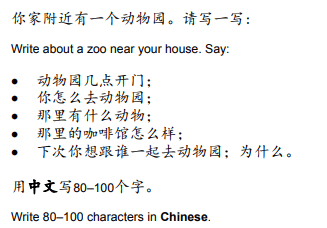

## Question 2

* This question tells you to describe something; it can be your friend, your holiday, your family, or even your school.
  * Question Example:

‎   

* Here’s an example for this question:

  “我的最好的朋友叫李佳龙，他今年十九岁了，他在大学专业计算机科学。

  在他的家，有他的爸爸妈妈，他的妹妹，还有他的佣人。他非常爱他的家庭。他的爸爸是一个博士，他的妈妈是一个家庭主妇。

  他的爱好是学数学，学中文，玩游戏。他喜欢学数学因为他觉得数学不仅有用，还有很有趣。他也喜欢学中文因为他觉得中文是很漂亮的语言。他还喜欢玩游戏，因为游戏可以让他跟朋友一起玩。

  我明天跟他学习，因为他的中文蛮好的，于是他教我中文。我认为他教的很好也很有意思。

  我喜欢他，因为他很善良，幽默，还很聪明。”

  **Translation**:

“My best friend is Li Jialong. He is 19 years old. He is studying computer science at university.

He lives with his mom, dad, little sister and his maid. His father is a doctor, while his mother is a housewife.

His hobbies are studying Mathematics, learning Chinese, and playing games. He likes to learn math because he thinks mathematics is not only helpful but also interesting. For Chinese, it’s because he thinks Chinese is a very beautiful language. He also likes to play games because games allow him to play with friends.

I will be studying with him tomorrow. Because his Chinese is very
good, so he teaches me Chinese. I think the way he teaches is very
well and very interesting.

I like him as a friend because he is very kind, humorous and smart.”

*And just like that we have over 200
words.*

**General tips:**

1. Start by doing the 1st question; try to put as many details as possible. In the case above, I introduced my friend by mentioning his name, his age, and where he is studying.
2. Use as many adjectives as possible; this will not only reach the number of words needed but also get you more marks.
3. Either relate it to your real-life situation or imagine it. In my case, I used my real-life friend as an example for this question so that I could answer easily because I know him well.
4. Try to think of the sentence that you plan to write in English first
   (or any language that you are comfortable with) then translate it to
   Chinese.

