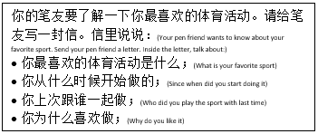

## Question 3

* You are given two topics and are only told to choose one and write about 150 words. E.g.

 ‎

* The question above tells us to send a letter to our pen pal about our favourite sport. They told me to write about my favourite sport, when I started liking it, with whom we have done the sports activity recently, and why we like it.
* Taking the letter-writing question is highly recommended because it is the easiest among the others.

Here’s an example:

“亲爱的李佳龙：

你好！你最近过得好吗？我想跟你说一说我最喜欢的体育活动。

我最喜欢的体育活动是踢足球，是一个很有名的体育活动。我开始踢足球从小的时候，大概五岁，跟爸爸一起踢足球。

上次，我跟我的朋友们在学校一起踢足球。在那个时候，我们的学校有足球比赛。我们的队赢了。

我喜欢踢足球，因为踢足球不仅可以让你身体健康，还是我觉得踢足球很有趣也很好玩。

期待早日收到你来信。祝你天天开心。

丽丽”

**Translation:**

“Dear Li Jialong:

Hello there! How are you doing? I want to tell you about my favourite
sport.

My favourite sport is playing football. It is a very famous sport. I started playing football when I was about five years old; I played football with my father.

Last time, I played football with my friends at school. At that time,
our school had a football match. Our team won.

I like to play football because playing football can not only make you healthy, but I also think it is exciting and fun.

Lili”

*That is about 180 words*