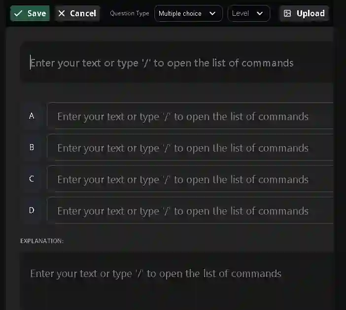
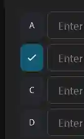
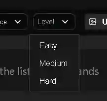
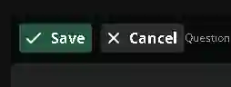
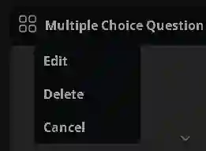

## **Using the ZNotes Admin Portal for Quizzes**

### **Here’s how to add your questions to the ZNotes website using ZNHQ:**

1. **Navigate to the Content Path:** Locate the specific module and corresponding chapter where the quiz questions need to be added.
   * *Prerequisite:* Authorized contributors will have visibility of their assigned subject/module. Ensure that the chapter notes are fully updated or created *before* generating or adding the quiz questions.
2. **Access the Quiz Editor:** Click the **"Create Quiz"** feature located alongside the chapter name (accessible to editors and contributors).

3. **Initialize a New Question:** On the newly opened page, click **"Add Question"**.

4. **Input Core Content:** Input the primary question text, populate the multiple-choice fields, and provide a detailed explanation in their respective text blocks.

5. **Format Content:** Use the integrated text editor formatting tools by typing a forward slash (`/`) to trigger the commands menu.

   * **Enhancements:** You can embed images or format mathematical equations using LaTeX.

   * *Formatting Restriction:* Do not apply any heading styles within the question or answer blocks; use standard text formatting only.

6. **Select the Correct Answer:** Identify and click on the correct choice (A, B, C, or D) to set it as the correct answer key.

7. **Assign Difficulty:** Designate the appropriate difficulty level for the question using the dropdown menu in the upper-right corner of the Quiz Card:
   * **Easy** (Level 1)

   * **Medium** (Level 2)

   * **Hard** (Level 3)

8. **Save Progress:** Click **"Save"** to finalize and upload the quiz question. If you wish to discard your current changes, click **"Cancel"**.

9. **Modifying Content:** To modify or remove existing questions, click the options icon (\[𓃎\]/ component grid) on the question card and select either **"Edit"** or **"Delete"** as required.

   

👉 Continue this process and develop **10 easy, 4 medium, 4 hard questions per chapter.**