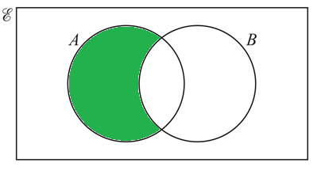

## Sets and Venn Diagram

**Question 2:**

1. $\varepsilon$ = {x: 2 $\leq$ x $\leq$ 16, x is an integer}
2. M = {even numbers}
3. P = {prime numbers}
4. i) Find $n\left( M \right)$. (1 Mark)
5. ii) Write down the set (*P* $\cup$ *M*)′. (1 mark)
6. On the Venn diagram, shade A ∩ B′. (1 mark)

<!-- -->

 

**Solution:**

**Part (1)(i)**

$n\left( M \right)$ *is the number of elements in set M. M is all the even numbers between 2 and 16 inclusive which is*

$${n}\left(M\right)= 8$$

**Part (1)(ii)**

$\left( P \cup M \right)^{'}$ *are the elements not in the union of sets P and M.*

$$(P\cup M)= {( 2, 3, 4, 5, 6, 7, 8, 10, 11, 12, 13, 14, 16 ) }$$

$$(P\cup M)^{'}={(9, 15)}$$

**Part (2)** 

