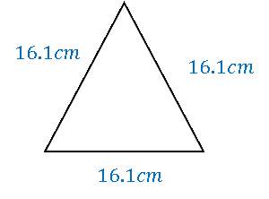

## Bounds

**Question 9:**

An equilateral triangle has sides of length 16.1 cm, correct to the
nearest millimetre. Find the lower and upper bounds of the perimeter of
the triangle. (2 marks)

**
Solution:
**

*An equilateral triangle has all sides and angles equal. We know that
each side is* $16.1cm\ $*to the nearest mm. This means that, each side
could be between* $16.15cm$ *and* $16.05cm$*. We can therefore
calculate:*

*The **minimum perimeter/lower bound** is:*

$$16.05 + 16.05 + 16.05 = \mathbf{48.15}\mathbf{\text{cm}}$$

*And the **maximum perimeter/upper bound** is:*

$$16.15 + 16.15 + 16.15 = \mathbf{48.45}\mathbf{\text{cm}}$$