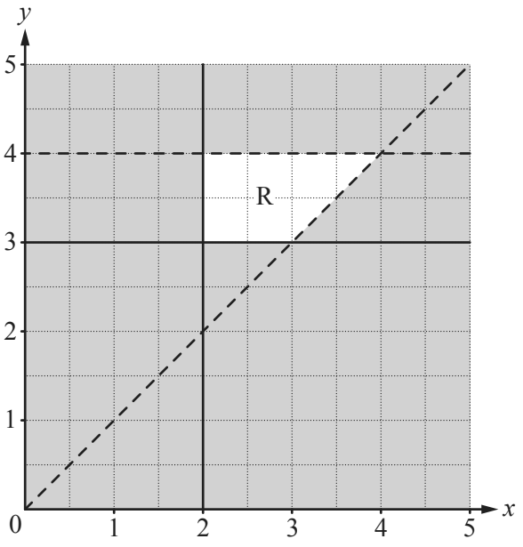

## Graphical inequalities

**Question 25:**

Find four inequalities that define the region, R, on the grid. (4 marks)

**
Solution:
**

*The lines on the grid that border R are*

$$y = 4$$

$$y = 3$$

$$x = 2$$

$$y = x$$

*R is above 3 and below 4, to the right of 2 and to the left of the
diagonal line. Note that solid lines mean* *we include them in the
inequality. This is written as*

$$\mathbf{y < 4}$$

$$\mathbf{y \geq 3}$$

$$\mathbf{x \geq 2}$$

$$\mathbf{y > x}$$

