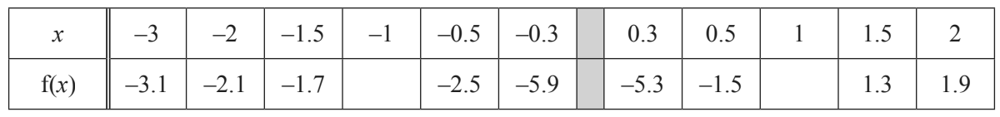
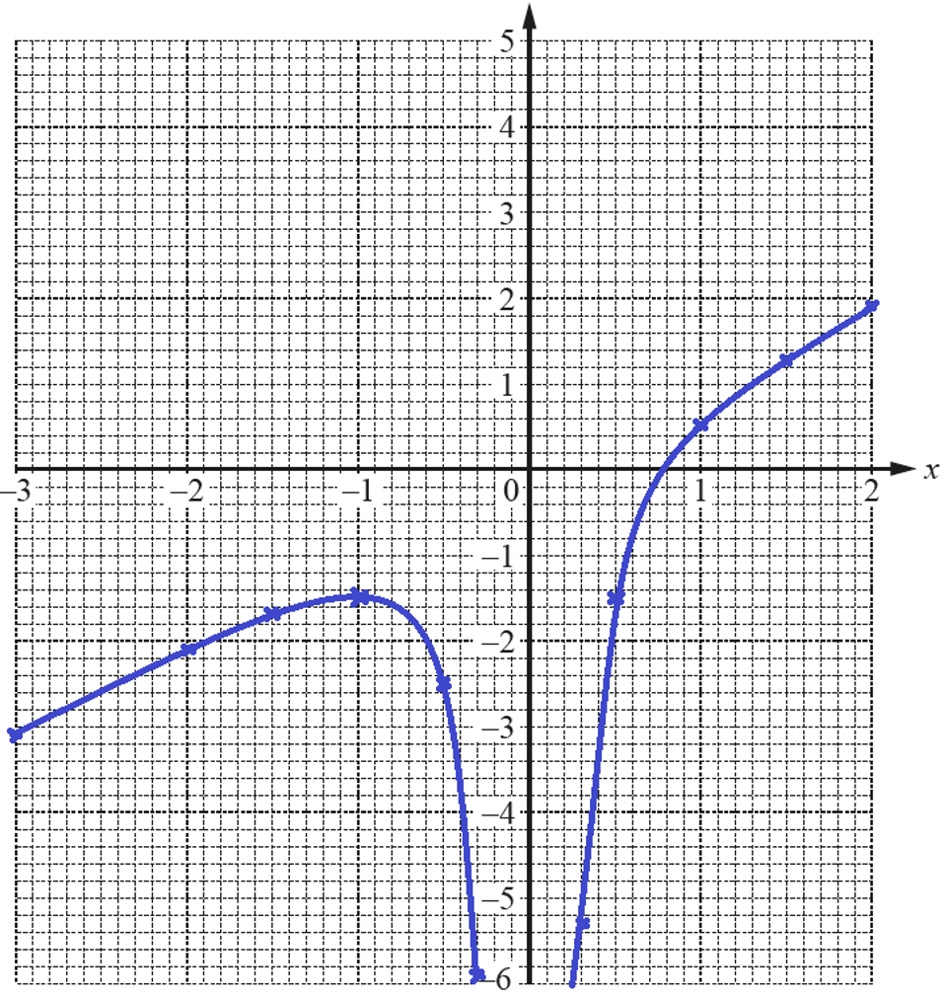
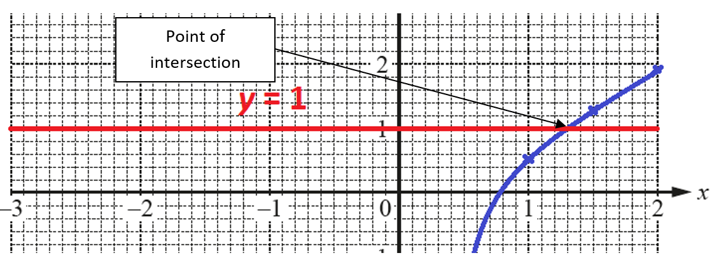
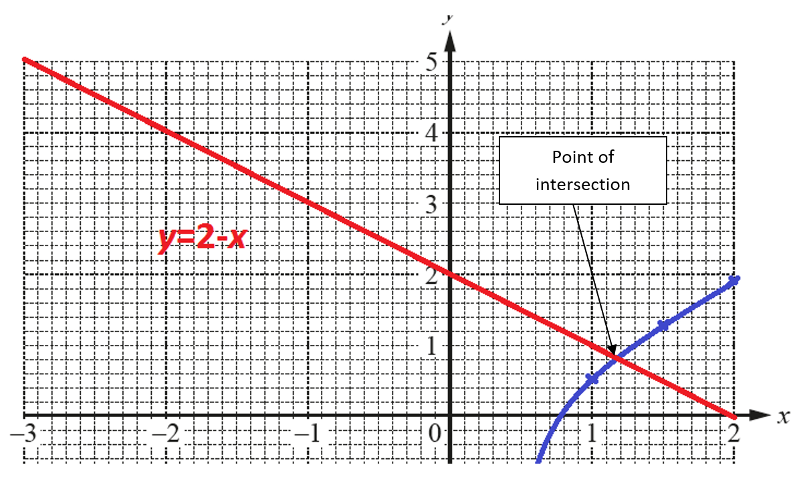

## Constructing Graphs & Solving Equations Graphically

**Question 29:**

$$f(x) = x - \frac{1}{2x^{2}}\ ,\ x \neq 0$$

a)  Complete the table of values. (2 marks)

   

b)  On the grid, draw the graph of $y = f\left( x \right)$ for –3
    $\leq$ x $\leq$ –0.3 and 0.3 $\leq$ x $\leq$ 2. (1 mark)

c)  Use your graph to solve the equation $f\left( x \right) = 1$ (1 mark)

d)  There is only one negative integer value, k, for which f(x) = k has
    only one solution for all real x. Write down this value of k. (1 mark)

e)  The equation $2x - \frac{1}{2x^{2}} - 2 = 0$ can be solved using
    the graph of y = f(x) and a straight-line graph.
    
I.  Find the equation of this straight line (1 mark)
    
II.  On the grid, draw this straight line and solve the equation $2x - \frac{1}{2x^{2}} - 2 = 0.$ (3 marks)

**Solution:**

**Part (a):**

We use calculator to find the values of $f\left( x \right)$ for x=-1
and x=1.

$$\mathbf{f}\left( \mathbf{- 1} \right)\mathbf{= - 1.5,\ \ f}\left( \mathbf{1} \right)\mathbf{= 0.5}$$

**Part (b):**

**Part (c):**

We plot the line y=1 and find the x-coordinate of the point of
intersection.

From the graph, we can see that the x-coordinate of the point is

$$\mathbf{x = 1.3}$$

**Part (d):**

From the graph, we can clearly see that $\mathbf{k = - 1}$, since for
-2 and any other negative integer, there are two solutions to f(x)=k.

$$\mathbf{k = - 1}$$

**Part (e)(i):**

Subtract (x-2) from both sides of the equation.

$$x - \frac{1}{2x^{2}} = 2 - x$$

We can see that the right side of the equation is our original function.

Therefore, the left-hand side must be the straight line we are looking
for.

$$\mathbf{y = 2 - x}$$

**Part (e)(ii):**

We plot a line $y = 2 - x$ and find the x-coordinate of the point of
intersection with the original graph to *solve*
$2x - \frac{1}{2x^{2}} - 2 = 0$

From the graph, we can see that the x-coordinate of the point, and hence
the solution to the equation

$2x - \frac{1}{2x^{2}} - 2 = 0$ is

$$\mathbf{x\  = \ 1.15}$$
