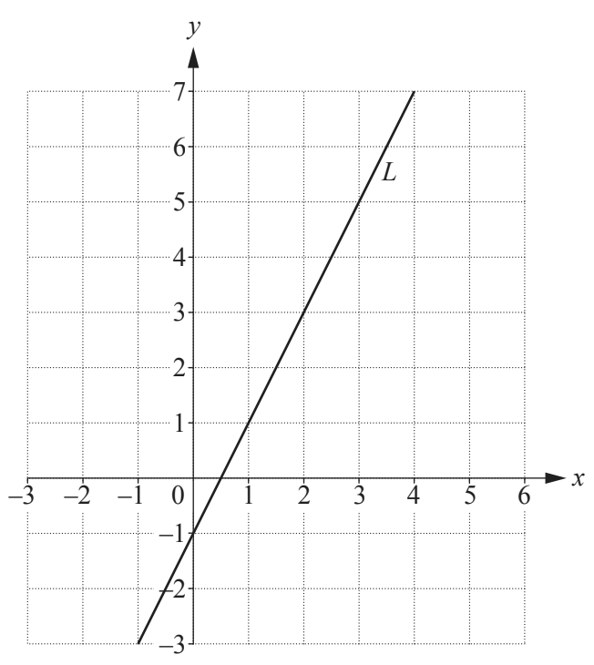

## Tangents & Gradients

**Question 30:**

a)  Work out the gradient of the line L (2 marks)

b)  Write down the equation of the line parallel to the line L that
    passes through the point (0, 6). (2 marks)

**
Solution:
**

**Part (a):**

*Gradient found by using*

$$m = \frac{y_2 - y_1}{x_2 - x_1}$$

*Choose the points (1, 1) and (0, -1)*

$$m = \frac{1 - ( - 1)}{1 - 0}$$

$$= \mathbf{2}$$

**Part (b):**

*Parallel means the same gradient, so 2. This gives us the equation*

$$y = 2x + c$$

*c is the y-intercept which is given as 6*

$$\mathbf{y = 2}\mathbf{x + 6}$$