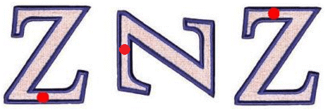

# Geometry

## Properties of Shapes

**Question 32:**

$$\mathbf{\text{Z E B R A}}$$

Write down the letters in the word above that have,

a)  Exactly one line of symmetry (1 mark)

b)  Rotational symmetry of order 2 (1 mark)

**
Solution:
**

**Part (a):**

*We can find out which letters in ‘ZEBRA’ have exactly 1 line of
symmetry like this: Imagine placing a mirror through the centre of each
letter at loads of different angles – a line of symmetry is where that
mirror would show us the letter we expect to see*

*For example, if we placed a mirror vertically down the centre of ‘A’,
between the paper and the mirror we would see ‘A’, so it has a line of
symmetry down its centre. **This works for E, B and A, so these 3
letters are the answer***

**Part (b):**

*Rotational symmetry is found by rotating the letter (from the word
‘ZEBRA’) around an imaginary point, which we place on one of the
corners ‘Order 2’ means that you could rotate the letter around the
imaginary point and it would look the same in 2 different positions (see
diagram below)*

**The only letter in ‘ZEBRA’ for which we can do this is Z – so the
answer is Z**