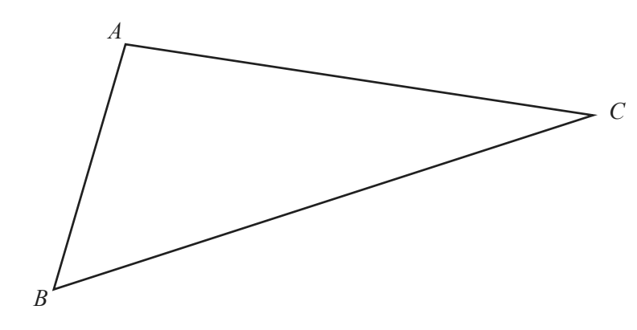
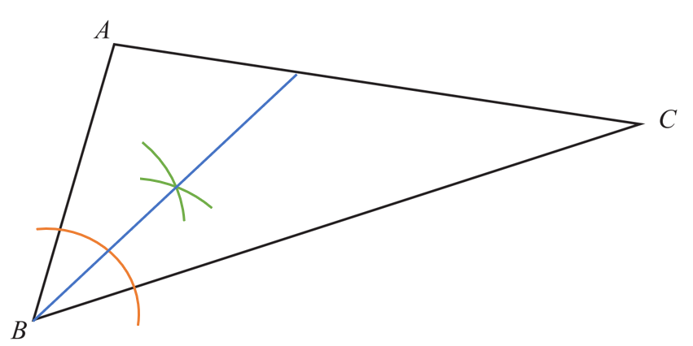
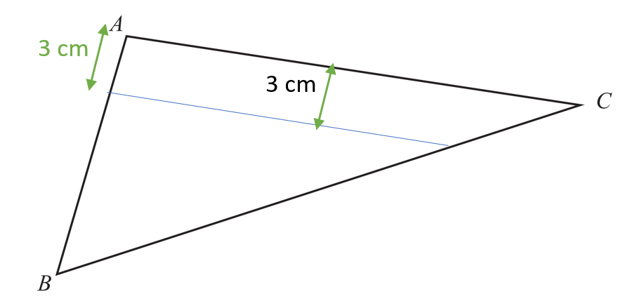

## Construction

**Question 33:**

This diagram shows triangle ABC

a)  **Using a straight edge and compasses only**, construct the bisector
    of angle ABC. (2 marks)

b)  Rotational symmetry of order 2 (1 mark)

**
Solution:
**

**Part (a):**

*The bisector of angle ABC is drawn in **blue.** Construction lines are
orange and green. You need to use a compass to do this construction and
ensure that construction lines are clearly shown.*

**Part (b):**

*Using a rule measure carefully 3cm from line AC to construct a parallel
line inside the triangle as shown.*

