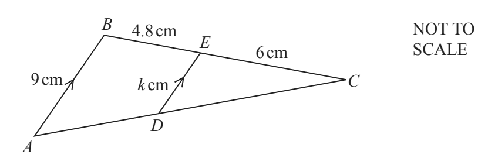
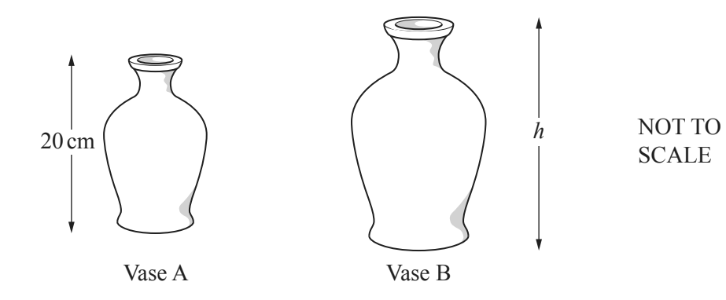

## Similarity

**Question 34:**

Triangles CBA and CED are similar. AB is parallel to DE. AB = 9 cm, BE =
4.8 cm, EC = 6 cm and ED = *k* cm.

a)  Work out the value of k. (2 marks)

b)  The diagram shows two mathematically similar vases. Vase A has
    height 20 cm and volume 1500 $cm^{3}$. Vase B has volume 2592
    $cm^{3}$. Calculate *h*, the height of vase B. (3 marks)

**
Solution:
**

**Part (a):**

*If we imagine that triangle ABC was shortened to create triangle CED
then the factor by which CB was shortened to create CE is the same
factor that shortened AB to make DE.*

$$CB = 10.8$$

$$CE = 6$$

*Thus, the scale factor is*

$$\frac{\text{CE}}{\text{CB}} = \frac{5}{9}$$

*Apply this factor to AB*

$$DE = \frac{5}{9} \times AB$$

$$\rightarrow k = 9 \times \frac{5}{9}$$

$$= \mathbf{5}$$

**Part (b):**

*The volume scale factor is*

$$\frac{2592}{1500} = 1.728$$

*This is the volume scale factor is the cube of the length (height)
scale factor. The height scale factor is therefore*

*And hence*

$$h_B = \frac{6}{5} \times h_A$$

$$= \mathbf{24}$$