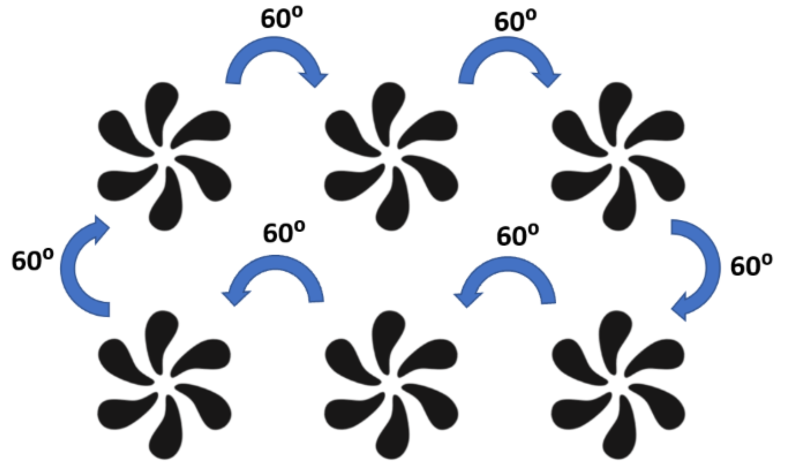
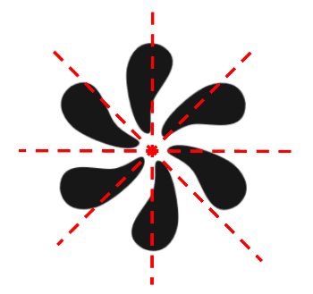

## Symmetry (in circles)

**Question 35:**

This diagram shows triangle ABC

a)  The order of rotational symmetry (1 mark)

b)  The number of lines of symmetry (1 mark)

**
Solution:
**

**Part (a):**

*The order of rotational symmetry of a shape is the number of times it
can be rotated around a full circle and still look the same. Hence by
inspection we can see that:*

**The order of rotational symmetry = 6**

**Part (b):**

*A line of symmetry is an imaginary line where you can fold the image
and have both halves match exactly. Hence by inspection we can see that
there are no lines of symmetry as the image will differ if folded over
any imaginary line. 6 such examples are shown below:*

**The number of lines of symmetry = 0**
