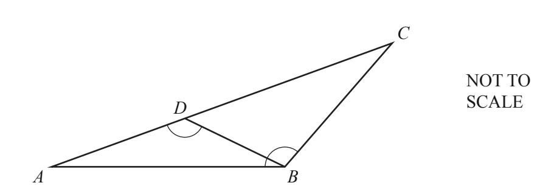
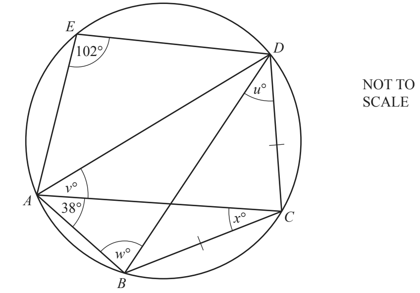
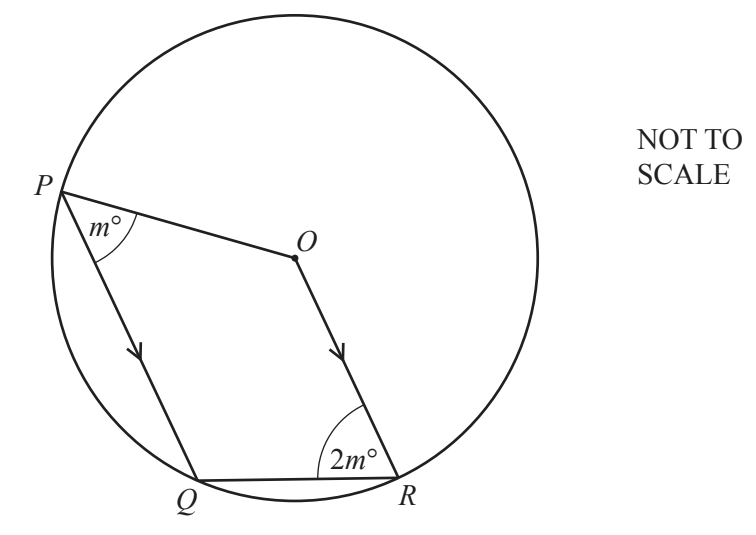
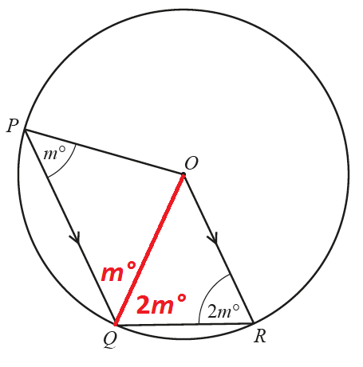

## Angles (Circles, Quadrilaterals, Polygons & Triangles)

**Question 36:**

a)  

In the diagram, *D* is on *AC* so that angle *ADB* = angle *ABC*.

i.  Show that angle *ABD* is equal to angle *ACB*. (2 marks)

ii.  Complete the statement. Triangles ABD and ACB are … (1 mark)

iii.  AB = 12 cm, BC = 11 cm and AC = 16 cm. Calculate the length of BD.
    (2 marks)

<!-- end list -->

b) 
     *A, B, C, D and E lie on the circle. Angle AED = 102° and angle BAC
     = 38°.* BC = CD. Find the value of

i.  ***u*,** (1 mark)

ii.  ***v*,** (1 mark)

iii.  ***w*,** (1 mark)

iv.  ***x*,** (1 mark)

c) 
     In the diagram, P, Q and R lie on the circle, centre O. PQ is
     parallel to OR. Angle QPO = m° and angle QRO = 2m°. Find the value
     of m. (5 marks)

**
Solution:
**

**Part (a)(i):**

*The sum of the interior angles of the two triangles (ABD and ACB) must
equal each other (and 180°).*

$$ABD + ADB + DAB = ABC + ACB + CAB$$

*The angles CAB and DAB are actually one and the same as D line on AC.*

$$ABD + ADB = ABC + ACB$$

Angles ADB = angle ABC.

Therefore: $\mathbf{ABD = ACB}$

**Part (a)(ii):**

*As the angles in these two triangles are the same, the triangles ABD
and ACB are similar.*

**
…similar
**

**Part (a)(iii):**

*The angles are similar, therefore the following ratios equal.*

$$\frac{\text{BD}}{\text{AB}} = \frac{\text{BC}}{\text{AC}}$$

*Using the lengths given.*

$$\frac{\text{BD}}{12\ cm} = \frac{11\ cm}{16\ cm}$$

*Multiply both sides by 12cm.*

$$BD = \frac{11}{16} \times 12cm$$

$$\mathbf{BD = 8.25}\mathbf{\text{cm}}$$

**Part (b)(i):**

*The angle BDC is subtended by the same points (B and C) as the angle
BAC, so they must be the same size. (Angles in the same segment are
equal)*

*Therefore*

$$\mathbf{u{^\circ} = 38{^\circ}}$$

**Part (b)(ii):**

*As the length of BC and CD are equal, so the angles BAC and CAD are
also equal.*

*Hence:*

$$\mathbf{v{^\circ}} = \mathbf{38{^\circ}}$$

**Part (b)(iii):**

*Opposite angles of a cyclic quadrilateral add up to 180°.*

*In this case, the opposite angles are AED and ABD.*

$$180{^\circ} = AED + ABD$$

$$180{^\circ} = 102{^\circ} + w{^\circ}$$

*Subtract 102° from both sides of the equation.*

$$\mathbf{w = 78{^\circ}}$$

**Part (b)(iv):**

*The interior angles of any triangle ABC sum to 180°.*

*The triangle BCD is an isosceles triangle, therefore angles DBC and BDC
have the same size 38°.*

$$180{^\circ} = ABC + BCA + CAB$$

$$180{^\circ} = \left( w{^\circ} + u{^\circ} \right) + x{^\circ} + 38{^\circ}$$

$$180{^\circ} = \left( 38{^\circ} + {^\circ}78{^\circ} \right) + x{^\circ} + 38{^\circ}$$

*Subtract 154° from both sides of the equation gives:*

$$\mathbf{x{^\circ} = 26{^\circ}}$$

**Part (c):**

*The sum of all interior angles of a quadrilateral is 360°.*

$$360{^\circ} = PQR + QRO + ROP + OPQ$$

*Two of these angles are known.* $POQ = m{^\circ}\ $*and*
$QRO = 2m{^\circ}$

*All length OP, OQ and OR must be equal as they are all radii of the
circle. This means that angles POQ and QOR are equilateral triangles.*

*Therefore, we know that the angle OPQ and OQP are the same and also OQR
is the same as ORQ.*

*By summing OQP and OQR, we get the size of angle PQR.*

$$PQR = OQP + OQR = OPQ + ORQ$$

$$PQR = m{^\circ} + 2m{^\circ} = 3m{^\circ}$$

*As the lines PQ and OR are parallel, the sum of angles at P and O must
be the same as the sum of angles at Q and R.*

$$ROP + OPQ = PQR + QRO$$

$$ROP + m{^\circ} = 3m{^\circ} + 2m{^\circ}$$

*Subtract m° from both sides to get the value of ROP.*

$$ROP = 4m{^\circ}$$

*Now we know all four angles of the original equation.*

$$360{^\circ} = 3m{^\circ} + 2m{^\circ} + 4m{^\circ} + m{^\circ}$$

$$360{^\circ} = 10m{^\circ}$$

*Divide both sides by 10 to work out the value of m.*

$$\mathbf{m = 36{^\circ}}$$
