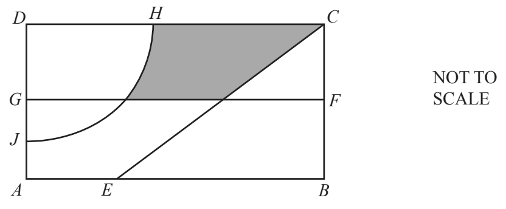

## Loci

**Question 37:**

The diagram shows a rectangular garden divided into different areas. FG
is the perpendicular bisector of BC. The arc HJ has centre D and radius
20 m. CE is the bisector of angle DCB. Write down two more statements
using loci to describe the shaded region inside the garden. (2 marks)

**
Solution:
**

*The shaded region is*

*  **nearer to C than to B**
*  **more than 20m from D**
*  **closer to CD than CB**

