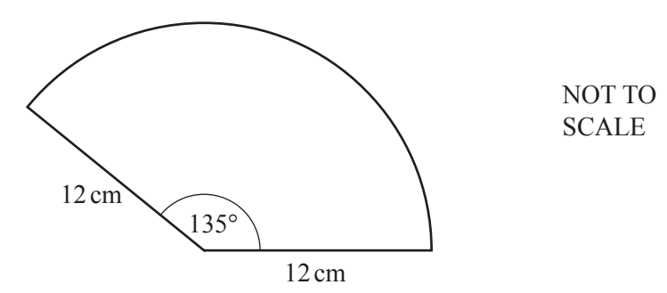

## Circle Problems (Area, Circumference, Arcs)

**Question 39:**

The diagram shows a sector of a circle of radius 12 cm with an angle of
135°. Calculate the perimeter of the sector. (3 marks)

**
Solution:
**

*Here we can use fractions to calculate the perimeter of the sector.*

*We know that a circle has a total angle of* $360{^\circ}$*, and here
we are looking at a sector of angle* $135{^\circ}.$ *Hence the
fraction of the circle we are looking at is*

$$\frac{135}{360} = \frac{3}{8}$$

*Now we want the perimeter of the total circle – this is an equation you
should have memorised.*

$$perimeter = circumference = 2\pi r$$

*Now we only want the fraction we found of this total result, so we can
multiply the two.*

$$arc\ perimeter = \frac{3}{8} \times 2\pi r = \frac{3}{4}\text{πr}$$

*We are given* $r = 12cm$*. We need to remember that the perimeter of
this shape also includes two radii, (I.e. Arc length plus two straight
sections (radii). Hence our total perimeter becomes:*

$$total\ perimeter = \frac{3}{4}\pi r + r + r = \frac{3}{4}\pi r + 2r$$

$$\mathbf{total\ perimeter =}\frac{\mathbf{3}}{\mathbf{4}}\mathbf{\pi}\left( \mathbf{12} \right)\mathbf{+ 2}\left( \mathbf{12} \right)\mathbf{= 52.3}\mathbf{\text{cm}}$$
