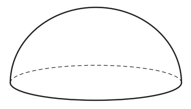
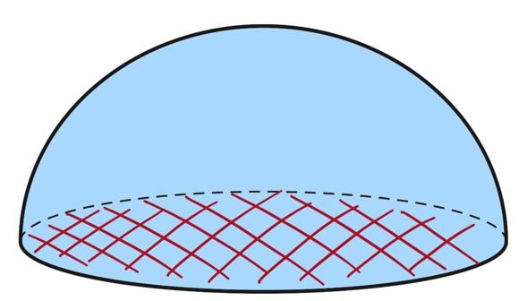

## 3D Shapes: Volumes & Surface Areas

**Question 39:**

The diagram shows a solid hemisphere.

The **total** surface area of this hemisphere is 243 π. The volume of
the hemisphere is *k* π. Find the value of *k*.

$\lbrack$The surface area, *A*, of a sphere with radius *r* is *A* =
4$\pi r^{2}$.$\rbrack$

$\lbrack$The volume, *V*, of a sphere with radius *r* is *V* =
$\frac{4}{3}\pi r^{3}$.$\rbrack$ (4 marks)

**
Solution:
**

*The surface area of a hemisphere (blue) is half that of a sphere
**plus** the area of the circle (red):*

$$\frac{1}{2} \times 4\pi r^{2} + \pi r^{2} = 3\pi r^{2}$$

*Equate this to the surface area of this hemisphere to find the radius,
r:*

$$3\pi r^{2} = 243\pi$$

$$r^{2} = 81$$

$$r = 9$$

*The volume of a hemisphere is half that of a sphere:*

$$V_{\text{hemisphere}} = \frac{1}{2} \times \frac{4}{3}\pi r^{3} = \frac{2}{3}\pi r^{3}$$

*Equate this to the volume of this hemisphere:*

$$\frac{2}{3}\pi r^{3} = k\pi$$

*Cancel out the* $\pi$ *and substitute r = 9:*

$$\frac{2}{3}{\times 9}^{3} = k$$

$$\mathbf{k = 486}$$