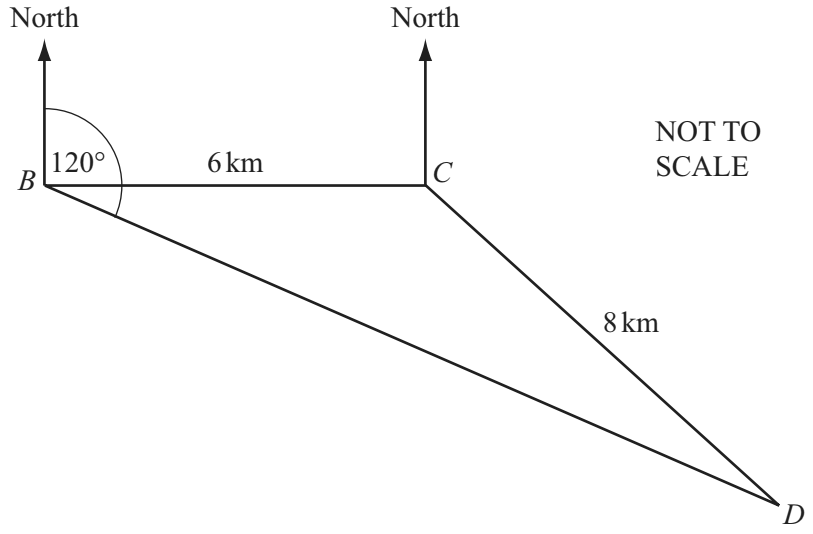
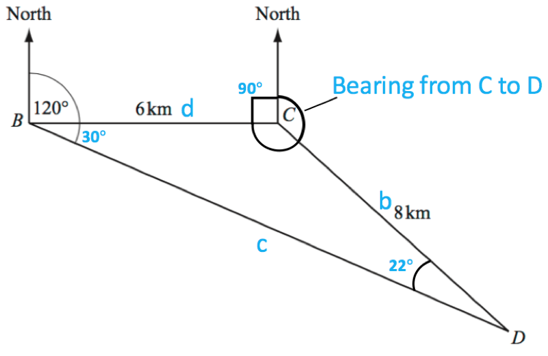

# Trigonometry

## Bearings

**Question 38:**

A helicopter flies from its base B to deliver supplies to two oil rigs at C and D. C is 6 km due east of B and the distance from C to D is 8 km. D is on a bearing of 120° from B.

Find the bearing of *D* from *C*. (5 marks)

**Solution:**

*To find the bearing of D from C we’ll need to find the size of the angle BCD, and then take that angle, and 90*${^\circ}$*, away from 360*${^\circ}$*. This is going to require us to use the ‘Sine Rule’ to find out the angles inside the triangle. The ‘Sine Rule’ can be used to find either the length of a side of a triangle, or an angle in a triangle – it goes like this:*

$$\frac{a}{\sin A} = \frac{b}{\sin B} = \frac{c}{\sin C}$$

*Angle DCB = 120*${^\circ} - 90{^\circ} = 30{^\circ}$

*So, applying the Sine rule:*

$$\frac{8}{\sin 30} = \frac{6}{\sin D}$$

$$\sin D ( \dfrac{8}{\sin 30} ) = 6$$

$$\sin D = \cfrac{6}{( \frac{8}{\sin 30} )}$$

$$D = \sin^{- 1} ( \cfrac{6}{( \frac{8}{\sin 30} )} )$$

$${D = 22.0{^\circ}}$$

*All angles within a triangle add up to 180°, so*

$${BCD = 180 - 30 - 22}{BCD = 128{^\circ}}$$

***Bearing from C to D*** $\mathbf{= 360 - 90 - 128 = 142{^\circ}}$