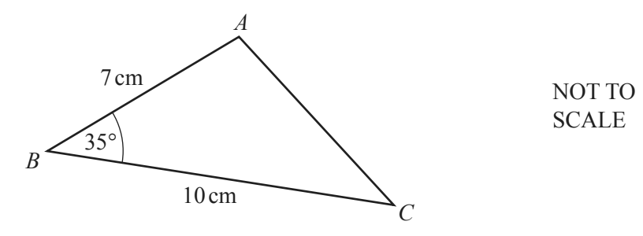

## Sine & Cosine Rule

**Question 40:**

a)  Calculate the area of triangle *ABC*. (2 marks)

b)  Calculate the length of *AC*. (4 marks)

**
Solution:
**

**Part (a):**

*Area of a triangle is*

$$A = \frac{1}{2}\text{ab}\sin C$$

$$A = \frac{1}{2} \times 7 \times 10 \times \sin 35$$

$$\mathbf{A =}\mathbf{\ (3}\mathbf{sf)}$$

**Part (b):**

*Using the cosine rule*

$$c^{2} = a^{2} + b^{2} - 2ab\cos C$$

$$c^{2} = 100 + 49 - 140\cos 35$$

$$c^{2} = 34.3$$

$$c = \sqrt{34.3}$$

$$\mathbf{c =}\mathbf{\ }\left( \mathbf{3}\mathbf{\text{sf}} \right)$$
